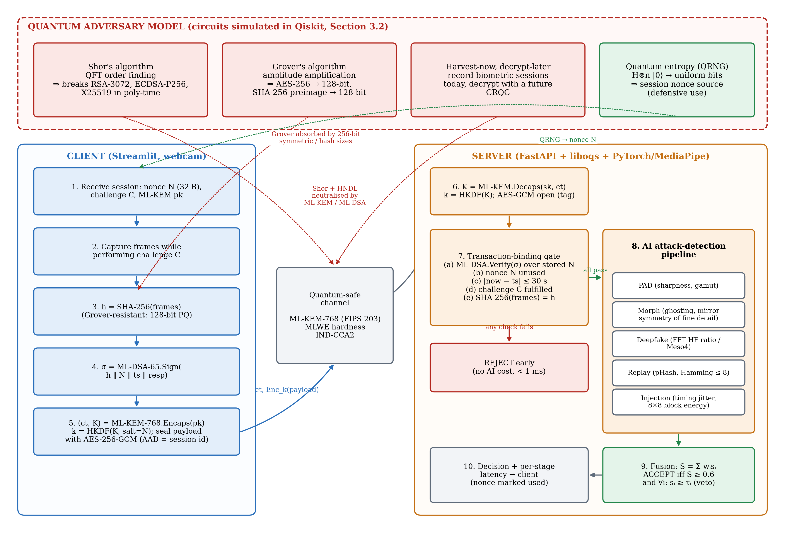
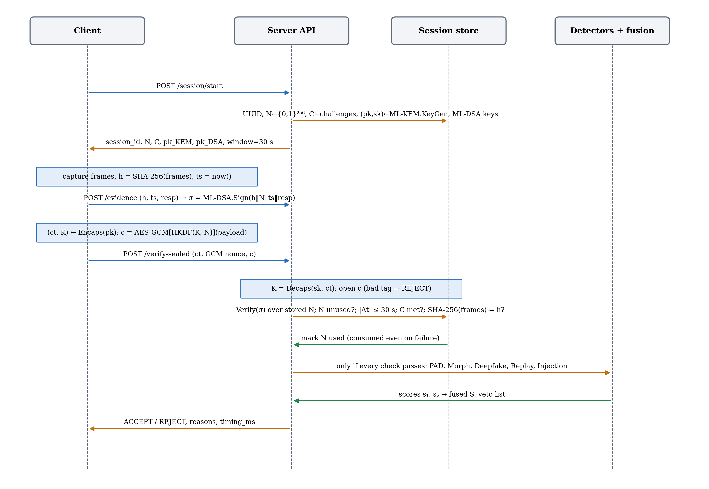
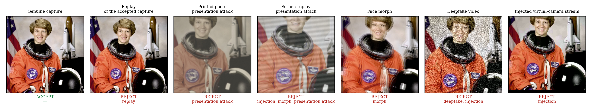

# AI-Based Biometric Evidence Authentication for Post-Quantum Digital Identity Systems

Remote identity checks (bank onboarding, e-KYC, digital ID) ask a person to
show their face to a camera and send it to a server. Two things can go
wrong. The channel is protected by RSA and elliptic-curve cryptography,
which quantum computers will break, so sessions recorded today can be
decrypted later. And even a perfectly secure channel says nothing about
whether the face in it is real: a deepfake sent over TLS is still a deepfake.

This project is a working prototype that addresses both. It checks that a
face capture is **genuine, live, unaltered, fresh and bound to one
session**, and sends it over a channel that stays secure against quantum
computers.



## Key features

- **Post-quantum channel.** The client runs **ML-KEM-768** (FIPS 203)
  against the session's key and encrypts the evidence with **AES-256-GCM**.
- **Transaction binding.** An **ML-DSA-65** (FIPS 204) signature over the
  evidence fingerprint, a single-use 256-bit nonce, a timestamp and the
  liveness-challenge answer; plus a 30 s freshness window and a check that
  the analysed frames are the signed ones. Any failure rejects the
  submission in about 1 ms, before any AI runs.
- **Live recording with a liveness challenge.** The dashboard records a
  4 s clip from the browser camera while the person performs a randomly
  chosen task (turn head, nod, say a number).
- **Five AI evidence checks:** presentation attack (photo or screen), face
  morph, deepfake, replay and injection (virtual camera), combined by
  weighted fusion where any single detector can veto.
- **Explained decisions.** Every rejection comes with plain-language reasons
  and the values that were measured.
- **Quantum threat model, simulated.** Shor's algorithm, Grover's algorithm
  and a quantum random number generator implemented in Qiskit and run on
  ideal and noisy simulators (`report/`).

## How it works



1. **Session.** The server issues a session ID, a one-time nonce, a random
   liveness challenge and an ML-KEM public key.
2. **Capture.** The person records a short clip: looking at the camera,
   then performing the challenge.
3. **Bind.** The frames' SHA-256 fingerprint is signed with ML-DSA together
   with the nonce, timestamp and challenge answer.
4. **Seal.** The client derives a key with ML-KEM-768 and HKDF and
   encrypts the submission with AES-256-GCM.
5. **Gate.** The server decrypts and checks the signature, nonce,
   freshness, challenge and frame fingerprint. Any failure → REJECT.
6. **Detect and decide.** Five detectors score the evidence. The fusion
   engine accepts only if the weighted score is ≥ 0.6 and no detector is
   below 0.5.
7. **Explain.** The response says why.

| Detector | What it checks |
|---|---|
| Presentation attack | Recapture cues on the face: true black level (paper and screens can't show black), sharpness, colour saturation |
| Morph | Double contours ("ghosting") and unnaturally symmetric fine texture left by blending two faces |
| Deepfake | Excess very-fine-detail energy left by face generators' upsampling |
| Replay | Whether this exact capture was already submitted: same picture **and** same pixel-level detail |
| Injection | Machine-perfect frame timing and re-encoding artifacts of video files and virtual cameras |

Why post-quantum: Shor's algorithm breaks RSA and elliptic curves, and
Grover's algorithm halves symmetric key strength. Both are simulated in
[`report/scripts/quantum_experiments.py`](report/scripts/quantum_experiments.py).
Detailed design: [`docs/ARCHITECTURE.md`](docs/ARCHITECTURE.md).

## Results at a glance

Measured on an Apple M3 laptop; details in [`report/FINAL_REPORT.md`](report/FINAL_REPORT.md) §4.4.

| | Result |
|---|---|
| ML-KEM-768 encaps + decaps vs RSA-3072 | 0.044 ms vs 2.14 ms (48× faster) |
| Post-quantum path on the server (decaps + AES-GCM + binding checks) | 0.88 ms, 1.9% of server time |
| Full verification, client side (sealed, 5 frames) | 109 ms median |
| Protocol attacks (stale, swapped frames, nonce reuse, wrong challenge, tampered channel) | 5/5 rejected in about 1 ms, before any AI |
| Content attacks (replay, printed photo, screen replay, morph, deepfake, injection) | 6/6 rejected by the intended detector |
| Genuine submissions | 41/41 accepted |
| Shor (N = 15) / Grover (4 qubits), ideal → 1% gate error | 0.499 → 0.132 / 0.960 → 0.430 success |



## Getting started

Two ways to run the server: **Docker**, which isolates the liboqs build and
gives the same image on every machine, or **native**, which is slightly
faster to iterate on. The dashboard always runs natively, because it uses
your browser's camera.

### Option A: Docker server + native dashboard (macOS)

**Prerequisites:** [Docker Desktop](https://www.docker.com/products/docker-desktop/)
installed and running (the whale icon in the menu bar), Python 3.11, and at
least 10 GB of free disk space. Works natively on Apple Silicon and Intel
Macs.

**1. Configure.** From the repo root:

```bash
cp .env.example .env
```

`.env` holds every setting (algorithms, thresholds, port) with working
defaults; no edits are needed to get started.

**2. Build and start the server.**

```bash
docker compose up --build
```

`docker compose` reads `docker-compose.yml`, which builds `Dockerfile`: a
Debian-slim image with the liboqs toolchain (cmake, ninja, gcc) that
installs `requirements.txt` and compiles liboqs. The first build takes a few
minutes; later builds are cached unless `requirements.txt` or the
`Dockerfile` change. The server then listens on `localhost:8000`. Wait for
`Application startup complete`. To run it in the background, use
`docker compose up --build -d` and follow the logs with
`docker compose logs -f server`.

**3. Check it,** in a new terminal:

```bash
curl http://localhost:8000/health
```

Expect `{"status":"ok","kem_alg":"ML-KEM-768","sig_alg":"ML-DSA-65","liboqs_ready":true}`.
The interactive API docs are at `http://localhost:8000/docs`.

**4. Start the dashboard:**

```bash
python3.11 -m venv .venv && source .venv/bin/activate
pip install -r requirements-client.txt
streamlit run client_demo/streamlit_app.py
```

This opens `http://localhost:8501`. The sidebar should say **Server online**.
With only `requirements-client.txt` installed it says **Client channel:
plaintext**: evidence goes to the server's plaintext `/verify` endpoint. The
demo is the same; only the wire format differs. For the full post-quantum
channel on the client too (**Client channel: sealed**), also build liboqs on
the Mac:

```bash
brew install cmake ninja openssl
pip install -r requirements.txt -r requirements-client.txt
```

**5. Build the demo samples and run the self-check:**

```bash
pip install scikit-image
python scripts/make_demo_assets.py        # writes demo_assets/attacks/ (gitignored)
python scripts/demo_check.py --explain    # expects "12/12 scenarios behaved as expected"
```

**Managing the container:**

```bash
docker compose ps                  # status
docker compose logs -f server      # logs
docker compose down                # stop and remove
docker compose up -d --force-recreate   # apply .env changes
```

`crypto/`, `detection/`, `binding/`, `server/`, `evaluation/` and
`demo_assets/` are mounted into the container and the server runs with
`--reload`, so code edits apply without a rebuild. Only dependency changes
need `docker compose up --build`.

**Troubleshooting (macOS + Docker):**

| Symptom | Fix |
|---|---|
| `Cannot connect to the Docker daemon` | Open Docker Desktop and wait until it is running |
| Container *unhealthy*, logs show `input/output error` | Your Mac's disk is (nearly) full and Docker's VM can't write. Free space, then quit and reopen Docker Desktop |
| Build fails or hangs at the liboqs/cmake step | Docker Desktop → Settings → Resources: more CPU/memory, then `docker compose up --build` |
| `port is already allocated` on 8000 | Something else owns port 8000 (often a native `uvicorn`): stop it, or `docker compose down` |
| `curl: (7) Failed to connect` right after starting | Still starting; wait for `Application startup complete` |
| Dashboard says *Server unreachable* | Check `curl http://localhost:8000/health`; `API_BASE_URL` in `.env` must be `http://localhost:8000` |

### Option B: fully native (no Docker)

```bash
brew install cmake ninja openssl
python3.11 -m venv .venv && source .venv/bin/activate
pip install -r requirements.txt -r requirements-client.txt
cp .env.example .env

uvicorn server.main:app --port 8000          # terminal 1
streamlit run client_demo/streamlit_app.py   # terminal 2
```

Full walkthrough: [`docs/SETUP_MACOS.md`](docs/SETUP_MACOS.md).

### Windows

liboqs needs Visual Studio Build Tools to compile natively, so the server
runs in Docker (`docker compose up --build`) and only the dashboard runs
natively (`pip install -r requirements-client.txt`, plaintext channel).
See [`docs/SETUP.md`](docs/SETUP.md).

## Using the dashboard

| Tab | What you do | Expected result |
|---|---|---|
| **Live Capture** | Start a session, press START on the video, then **Record**: look at the camera, then do the challenge shown on the video. Verify. | ✅ ACCEPT for a real, live person |
| **Simulate Attack** | Pick a pre-made sample (genuine, replay, printed photo, screen replay, morph, deepfake, injection) or upload a file | ❌ REJECT, naming the detector and why |
| **Tamper with Protocol** | Break one protocol rule on a genuine capture: swapped frames, flipped bit, stale timestamp, reused nonce, wrong answer | ❌ REJECT by the cryptographic layer in about 1 ms |

Each result shows the post-quantum channel used, every binding check, each
detector's score and verdict, and a **"Why was this rejected?"** list. A
step-by-step presenter's guide is in [`GUIDE.md`](GUIDE.md).

## Project structure

```
crypto/         ML-KEM / ML-DSA wrappers (liboqs), AES-256-GCM channel, RSA/ECDSA baseline
binding/        Transaction binding: signature, nonce, freshness, challenge checks
detection/      Five detectors, face-region helper, liveness-challenge check, fusion engine
server/         FastAPI app: sessions, sealed verification pipeline, decision explanations
client_demo/    Streamlit dashboard, clip recorder, API client
evaluation/     Benchmark harness (latency, PQC vs classical, throughput), ISO 30107-3 metrics
scripts/        make_demo_assets.py (demo samples), demo_check.py (self-check)
tests/          105 unit and API tests
report/         Final report, figures, raw data, experiment scripts (incl. Qiskit circuits)
docs/           Architecture, setup guides, study guide, original specification
datasets/       Download instructions only (datasets are not committed)
demo_assets/    Generated demo samples (gitignored) and their description
```

## API

| Endpoint | Purpose |
|---|---|
| `GET /health` | Status, algorithms, liboqs readiness |
| `POST /session/start` | New session: nonce, challenge, ML-KEM public key, ML-DSA identity |
| `POST /session/{id}/evidence` | ML-DSA-sign the binding payload (see Limitations) |
| `POST /session/{id}/verify-sealed` | Sealed (ML-KEM + AES-256-GCM) submission → binding → AI → decision + explanations |
| `POST /session/{id}/verify` | Same pipeline for clients without liboqs (plaintext) |
| `POST /session/{id}/channel` | Server-side ML-KEM round trip, for diagnostics |
| `POST /demo/reset-replay-store` | Clear replay memory between rehearsals (`DEMO_MODE=true` only) |
| `DELETE /session/{id}` | Close a session and free its keys |

## Testing and reproducibility

```bash
pytest tests/ -q                                 # 105 tests; liboqs-dependent ones skip without liboqs
python scripts/demo_check.py --explain           # 12 attack/genuine scenarios against a running server
python report/scripts/system_experiments.py      # regenerates the report's tables and figures
```

The quantum experiments need Qiskit in a separate environment
(`pip install -r report/requirements-report.txt`); see Appendix A of the report.

## Limitations

- **Detectors are heuristics, not trained models.** Each has a documented
  path to a pretrained model (MiniFASNet, Meso4;
  [`detection/README-models.md`](detection/README-models.md)), but none is
  bundled. They were calibrated on one public-domain portrait, its attack
  derivatives and simulated webcam conditions. The results show each layer
  working as designed; they are not accuracy figures on a dataset, and a
  high-quality print in good light can defeat the presentation-attack cues.
- **Signing happens in the server process.** The client encrypts the channel
  itself, but the per-session ML-DSA "client identity" lives on the server,
  so that a Windows client never needs liboqs. A production client would
  hold its own key (device or TEE).
- **Challenges.** Head movements are verified from the recording; spoken
  numbers are checked by string match (no speech recognition).
- **In-memory state.** Sessions and replay memory live in one process; a
  multi-server deployment would need a shared store such as Redis.
- **Quantum results are simulations** on a parametric noise model, not
  real quantum hardware.

## Future work

- Plug in pretrained MiniFASNet and Meso4 and measure APCER/BPCER on
  CelebA-Spoof, FaceForensics++ and AMSL.
- A trained virtual-camera detector, so injected *still images* are caught
  too.
- Sign on the client device or in a TEE, so the private key never leaves the
  capture device.
- Hybrid X25519 + ML-KEM-768 key exchange for the transition period.
- Feed session nonces from a quantum random number generator (with HKDF
  conditioning), and run the Shor/Grover circuits on IBM Quantum hardware.
- Speech recognition for spoken-number challenges; Redis-backed state for
  horizontal scaling.

## Documentation

| Document | For |
|---|---|
| [`GUIDE.md`](GUIDE.md) | Presenter's guide: running the demo, showing each ACCEPT/REJECT |
| [`docs/ARCHITECTURE.md`](docs/ARCHITECTURE.md) | Verification flow, detectors, security properties |
| [`docs/SETUP_MACOS.md`](docs/SETUP_MACOS.md), [`docs/SETUP.md`](docs/SETUP.md) | Detailed setup (macOS, Windows) |
| [`docs/STUDY_GUIDE.md`](docs/STUDY_GUIDE.md) | Background: PQC, algorithms, detectors, terminology |
| [`report/FINAL_REPORT.md`](report/FINAL_REPORT.md) | Full report with quantum circuits, results and references |
| [`CHANGELOG.md`](CHANGELOG.md), [`CLAUDE.md`](CLAUDE.md) | Change history, contributor conventions |
