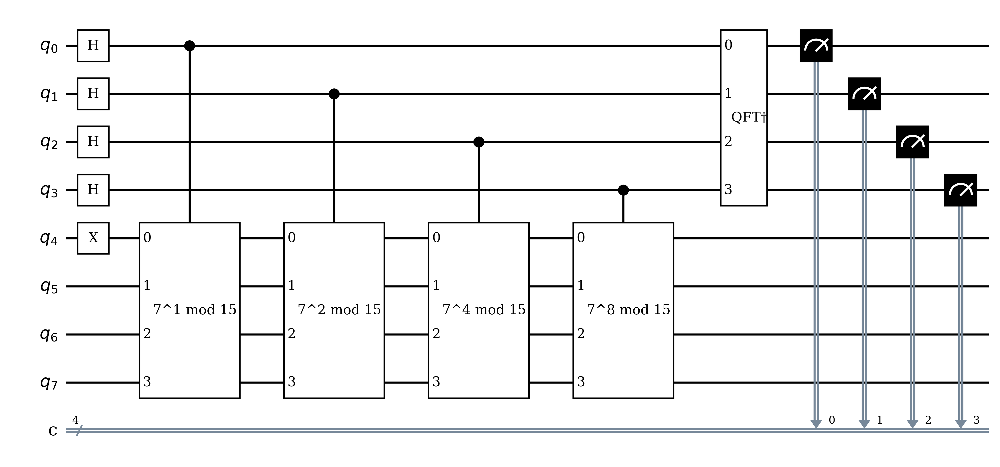
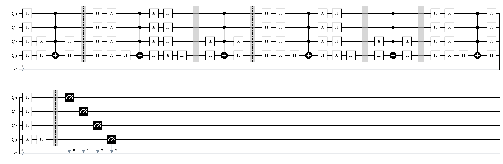
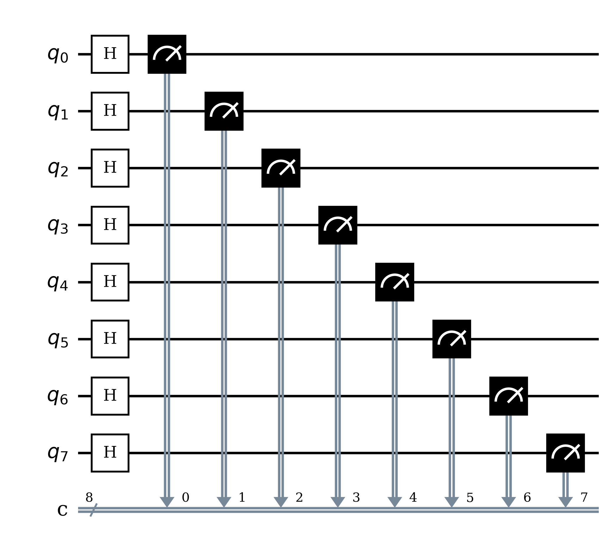
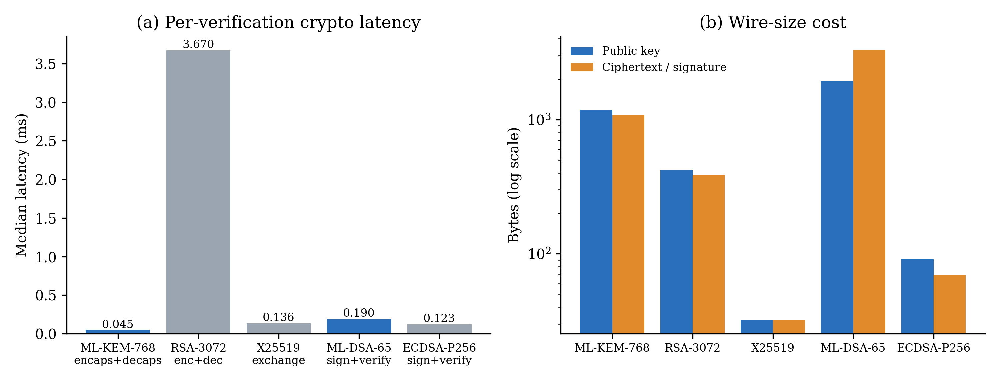
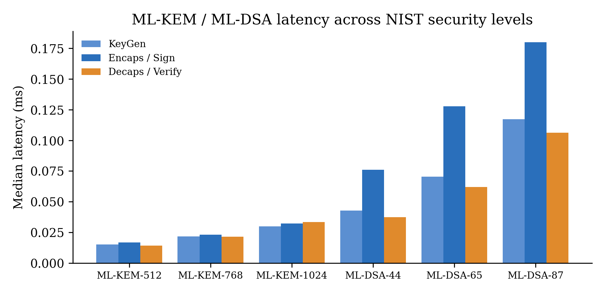
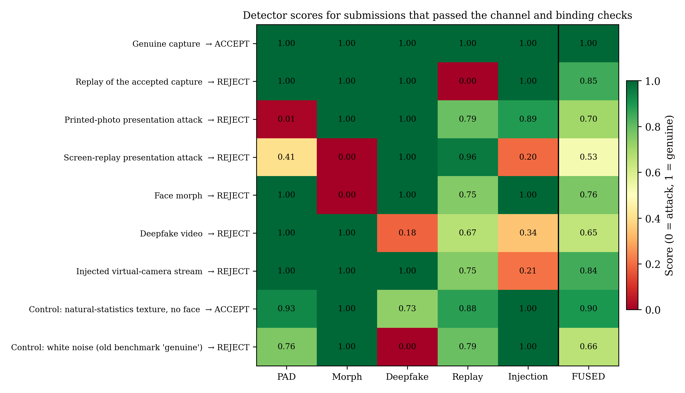
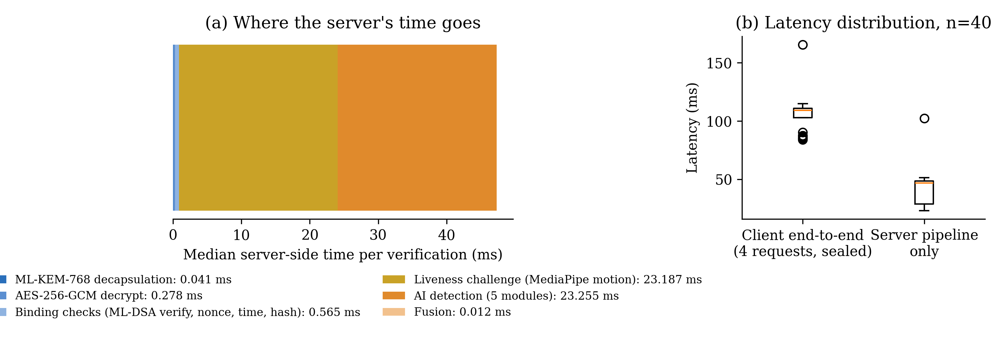
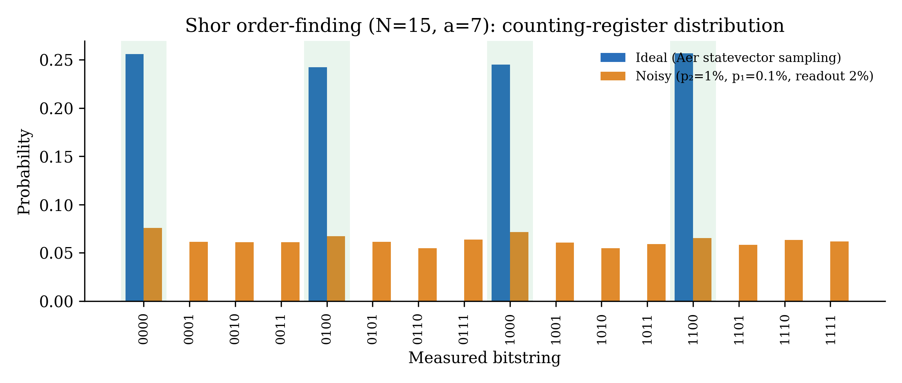
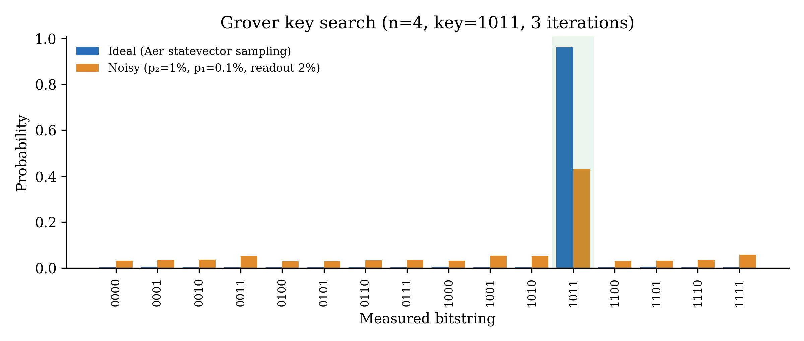
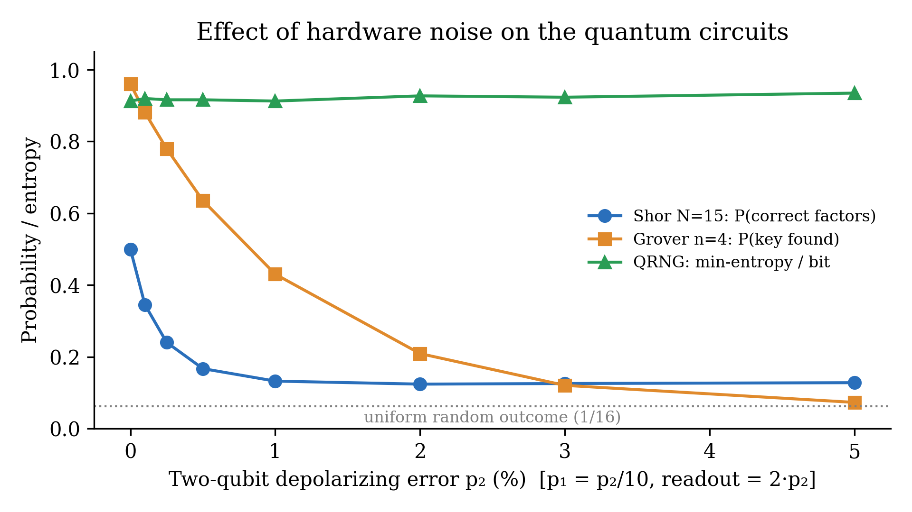

<!--
FORMATTING NOTE FOR WORD/LaTeX CONVERSION (remove before submission):
- Title, section headings: Times New Roman 15 pt, bold.
- Body text and abstract: Times New Roman 12 pt.
- All figures referenced below are in ./figures (300 dpi PNG); raw data in ./data.
- Every figure/table can be regenerated with the scripts in ./scripts (see Appendix A).
- Items marked [[PLACEHOLDER: ...]] must be filled by the team.
-->

# AI-Based Biometric Evidence Authentication for Post-Quantum Digital Identity Systems

**[[PLACEHOLDER: Student Name 1]]**, Regd. No. [[PLACEHOLDER]], [[PLACEHOLDER]]@gmail.com
**[[PLACEHOLDER: Student Name 2]]**, Regd. No. [[PLACEHOLDER]], [[PLACEHOLDER]]@gmail.com
**[[PLACEHOLDER: Student Name 3]]**, Regd. No. [[PLACEHOLDER]], [[PLACEHOLDER]]@gmail.com

[[PLACEHOLDER: Department, Institution, Course code and name, Faculty guide]]

---

## Abstract

Remote identity verification (e-KYC, bank onboarding and government digital ID) depends on two assumptions: that the channel carrying a biometric capture is confidential and authentic, and that the capture itself is a genuine, live and fresh image of the claimed person. Today's systems protect the channel with RSA and elliptic-curve cryptography, which Shor's algorithm will break once a cryptographically relevant quantum computer exists. Adversaries can therefore record biometric sessions now and decrypt them later ("harvest now, decrypt later"). Channel security also says nothing about the content: a deepfake sent over a perfectly secure channel is still a deepfake. This project designs, implements and evaluates a prototype that closes both gaps in one pipeline. Each capture is sealed with AES-256-GCM under a key from an ML-KEM-768 (FIPS 203) encapsulation, and is cryptographically bound to a single verification session by an ML-DSA-65 (FIPS 204) signature over the evidence hash, a 256-bit single-use nonce, a timestamp and a liveness-challenge response. Only evidence that passes this binding gate, including a check that the submitted frames are the ones that were signed, is analysed by five AI and signal-processing detectors (presentation attack, morphing, deepfake, replay and injection), whose scores are combined by a weighted fusion engine with per-module veto. To make the quantum threat model concrete rather than assumed, we implemented and simulated in Qiskit the three quantum circuits that define it. Shor's order-finding for N = 15 recovers the factors with probability 0.499 in the ideal case (theoretical 0.5). Grover's search over a 4-qubit key space succeeds with probability 0.960 (theoretical 0.961). An 8-qubit Hadamard quantum random number generator (QRNG) is proposed as a session-nonce source. Noise sweeps show that a two-qubit error rate of 1% drops Shor's success to 0.132 and Grover's to 0.430, which quantifies why fault tolerance, not qubit count alone, governs the attack timeline. On an Apple M3, ML-KEM-768 encapsulation plus decapsulation takes 0.044 ms, 48 times faster than RSA-3072. The whole server-side post-quantum path (decapsulation, payload decryption and the cryptographic binding checks) costs 0.88 ms, 1.9% of server processing time. In a twelve-scenario evaluation driven through the real client over the sealed channel, a genuine capture derived from a real face was accepted, and every rejection carries a plain-language explanation of what was measured. All five protocol attacks were rejected in under 1 ms before any AI ran, and all six content attacks were rejected by the detector designed for them. All 40 distinct genuine sessions were accepted. Testing on a real face and on simulated webcam recordings also exposed and led us to fix nine defects, among them a presentation-attack check that rejected every real webcam frame, a replay check that rejected a person's second genuine recording, and a gap that let frames be swapped after signing. The work shows that quantum-safe biometric evidence authentication is practical today at negligible latency cost. It also shows that the binding layer, not the cipher alone, is what turns post-quantum cryptography into protection for biometric evidence.

**Keywords:** Biometric presentation attack detection; Deepfake detection; ML-DSA; ML-KEM; Post-quantum cryptography; Shor's algorithm

---

## 1. Introduction

Digital identity has moved from the branch counter to the smartphone camera. Banks, telecom operators and government ID schemes now onboard and re-authenticate users by asking them to show their face to a camera, then send the capture over the network to a verification server. The security of that interaction rests on public-key cryptography: TLS key exchange (ECDHE or RSA) keeps the capture confidential, and digital signatures (ECDSA or RSA) authenticate the parties. Both families rest on the hardness of integer factorisation and discrete logarithms, problems that Shor's algorithm solves in polynomial time on a fault-tolerant quantum computer [1]. Resource estimates for breaking RSA-2048 have fallen from about 20 million noisy qubits [6] to fewer than one million [7]. NIST has responded by standardising the lattice-based ML-KEM [3] and ML-DSA [4] and publishing a deprecation timeline for quantum-vulnerable algorithms [29].

Biometric data makes the quantum threat unusually serious. A password can be rotated after a breach; a face cannot. Encrypted biometric sessions recorded today can be decrypted once a cryptographically relevant quantum computer (CRQC) exists. This "harvest now, decrypt later" (HNDL) attack means data with a long confidentiality lifetime must be protected with quantum-resistant cryptography *now* [8], [9]. The quantum threat is not limited to public-key schemes either. Grover's algorithm [2] gives a quadratic speed-up for brute-force key search and hash pre-image search, halving the effective security of AES and SHA-2 [26].

A second, orthogonal problem is that cryptography secures the *channel*, not the *content*. A presentation attack (a printed photo or replayed screen) [13], a face morph that matches two identities [17], a GAN-generated deepfake [14], [16], a replay of a previously captured genuine sample, or a synthetic stream injected through a virtual camera all travel through a perfectly encrypted, perfectly authenticated channel. The cryptography then faithfully delivers forged evidence. Existing liveness and anti-spoofing products address content but rely on classical cryptography and rarely bind a capture to a specific session, a gap now recognised by the digital-identity industry itself [28]. Recent work combining spoofing detection with PQC [24] treats the two as adjacent layers rather than one protocol [25].

The problem assigned to our team is therefore: **design a biometric verification pipeline in which (i) every cryptographic primitive is secure against a quantum adversary, (ii) each piece of biometric evidence is provably tied to one session, and (iii) the content of the evidence is checked for all five major attack classes, then quantify the cost and the residual risk.** Quantum computing enters this problem in two ways. As a *threat*, Shor's and Grover's algorithms dictate which primitives must be replaced and how large the remaining symmetric keys and hashes must be. Simulating these circuits, including under realistic noise, turns that threat model from an assertion into a measured result. As a *resource*, measuring a qubit prepared in an equal superposition yields intrinsically unpredictable bits [19], which is a natural source for the session nonces that binding depends on.

Following from the above, the specific objectives of this course project are:

- **O1:** Replace every quantum-vulnerable primitive on the verification path with NIST-standardised post-quantum schemes (ML-KEM-768 for key establishment and ML-DSA-65 for signatures), keeping AES-256-GCM and SHA-256 sized for Grover.
- **O2:** Design a *transaction-binding* protocol that cryptographically ties each capture to a single-use nonce, a freshness window and a liveness challenge, carries it over a sealed ML-KEM + AES-256-GCM channel, and rejects tampered, substituted, stale, reused or pre-recorded evidence before any AI runs.
- **O3:** Build a five-module AI/signal-processing detection pipeline (PAD, morph, deepfake, replay and injection) with a fusion and veto decision engine.
- **O4:** Implement and simulate the quantum circuits that define the threat model (Shor, Grover) and a quantum-entropy source (QRNG) in Qiskit, on ideal and noisy back-ends.
- **O5:** Quantify PQC versus classical overhead (latency and bytes on the wire), end-to-end latency, the defence layer that stops each attack class, and the effect of quantum noise on the attack circuits.

**Novelty.** The project's main contribution is to treat post-quantum cryptography and biometric attack detection as **one protocol rather than two layers stacked side by side**. The ML-DSA signature covers `SHA-256(evidence) ‖ nonce ‖ timestamp ‖ challenge-response`. The server rebuilds that payload from the nonce it stored itself, verifies it, and checks that the frames it received hash to the signed value, all before any detector runs. As a result, replayed, substituted, stale or pre-recorded evidence is rejected cryptographically in under 1 ms, even when the biometric content is 100% genuine. A content classifier cannot achieve this, because a replayed genuine sample *is* genuine. Second, the quantum threat model is *executed, not assumed*. We map each quantum algorithm to the specific primitive it attacks and the countermeasure in our architecture (Fig. 1), and simulate the Shor, Grover and QRNG circuits, including noise sweeps. This shows that gate error, not qubit count, separates today's devices from an attack, and that a QRNG nonce source needs randomness extraction under asymmetric readout noise. Third, we report measured, reproducible costs on commodity hardware: the post-quantum path is 1.9% of server time, and ML-KEM is 48 times faster than the RSA-3072 it replaces. We also report what testing on a real face revealed and how each defect was fixed. Among these were presentation-attack and morph detectors that rejected real webcam faces, a replay check that confused a person's second genuine recording with a resubmission, an injection heuristic that rewarded machine-perfect frame timing, and a missing check that the analysed frames are the signed ones. None of these appeared in the original synthetic benchmark.

The remainder of this report is organised as follows. Section 2 reviews related work, introduces the quantum prerequisites and identifies the gap. Section 3 formulates the problem and presents the system architecture, the quantum circuits and the implementation. Section 4 describes the experimental setup, presents the screenshots and the results, and compares classical and quantum performance under noise. Section 5 discusses novelty, insights and limitations, and Section 6 concludes.

---

## 2. Background and Related Work

### 2.1 Literature Review

**Quantum attacks on cryptography.** Shor showed that period finding with the quantum Fourier transform (QFT) factors integers and computes discrete logarithms in polynomial time [1], breaking RSA, finite-field Diffie-Hellman and elliptic-curve cryptography. The smallest instance, N = 15, was first demonstrated on NMR hardware by Vandersypen *et al.* [20]. Gidney and Ekerå estimated that RSA-2048 could be factored in 8 hours with 20 million noisy qubits [6], and Gidney later reduced this to under one million qubits in under a week [7]. Grover's algorithm [2] finds a marked item among 2ⁿ in O(2^{n/2}) oracle calls. Grassl *et al.* produced concrete circuits for Grover attacks on AES [26], confirming that AES-128 falls to 64-bit quantum security while AES-256 keeps 128 bits.

**Post-quantum cryptography.** Bernstein and Lange survey the families of post-quantum cryptography (lattices, codes, hashes, multivariate and isogenies) [8]. Mosca's inequality, "shelf-life + migration time > time-to-CRQC ⇒ act now", formalises the urgency for long-lived secrets such as biometrics [9]. NIST selected CRYSTALS-Kyber [10] and CRYSTALS-Dilithium [11], standardised as ML-KEM [3] and ML-DSA [4]. Both reduce to Module Learning With Errors (MLWE), a structured variant of Regev's LWE problem [12]. The Open Quantum Safe project's liboqs [5] provides the reference implementations used here, and NIST IR 8547 [29] sets the timeline for deprecating RSA and ECC.

**Biometric attack detection.** ISO/IEC 30107-3 defines presentation attack detection (PAD) and its APCER/BPCER metrics [13]. CelebA-Spoof [18] and lightweight CNNs such as MiniFASNet [27] are standard for PAD. For deepfakes, FaceForensics++ [14] is the benchmark of record. MesoNet/Meso4 [15] is a compact CPU-friendly detector, and Frank *et al.* [16] showed that GAN up-sampling leaves characteristic high-frequency spectral artefacts. Scherhag *et al.* [17] survey morphing attacks and landmark- and texture-based morph detectors. Bathaei *et al.* [25] review deep-learning face and speaker recognition and note the continuing gap in replay and injection defences. The most closely related work, N S *et al.* [24], integrates spoofing detection with PQC but does not bind evidence to a session or address replay or injection.

**Quantum randomness and key derivation.** Measuring |+⟩ yields a fair, physically unpredictable bit. Herrero-Collantes and Garcia-Escartin review QRNG constructions and the randomness extraction they need when hardware is biased [19]. HKDF [23] is the standard extractor-then-expander, and the prototype already uses it for channel keys.

### 2.2 Theoretical Framework

**State vectors and superposition.** An n-qubit register is a unit vector |ψ⟩ = Σ_{x∈{0,1}ⁿ} α_x |x⟩ in ℂ^{2ⁿ}, with Σ|α_x|² = 1. Measuring in the computational basis yields x with probability |α_x|² (the Born rule) [21].

**Unitary gates.** Computation is a sequence of unitary operators U (U†U = I). The gates used in this work are:

| Gate | Matrix / action | Role in this project |
|---|---|---|
| Hadamard H | (1/√2)[[1, 1], [1, −1]]; \|0⟩ → \|+⟩ | Creates uniform superposition (Shor counting register, Grover, QRNG) |
| Pauli-X | [[0, 1], [1, 0]] | Initialises \|1⟩ work register (Shor); oracle/diffuser bit flips (Grover) |
| CNOT / multi-controlled X | flips target iff all controls are 1 | Grover oracle and diffuser; entanglement |
| SWAP, controlled-SWAP | exchanges two qubits | Builds the modular multiplier U\|y⟩ = \|7y mod 15⟩ |
| Controlled phase R_k | diag(1, e^{2πi/2^k}) | Inside the inverse QFT |
| Measurement | projective, Z basis | Read-out of phase estimate / key / random bit |

**Table 1.** Quantum gates used in the implemented circuits.

**Quantum Fourier transform.** QFT|x⟩ = (1/√2ⁿ) Σ_y e^{2πi xy/2ⁿ} |y⟩. Applied in reverse after phase kickback, it converts a periodic phase into a measurable integer close to 2ⁿ·s/r, which is the core of Shor's order finding [1].

**Phase estimation and order finding.** For U_a|y⟩ = |a·y mod N⟩, the eigenvalues of U_a are e^{2πi s/r}, where r is the order of a mod N. Controlled-U_a^{2^j} gates kick these phases into the counting register; QFT† and continued fractions then recover r. If r is even and a^{r/2} ≢ −1 (mod N), then gcd(a^{r/2} ± 1, N) yields non-trivial factors.

**Amplitude amplification.** Grover's oracle O|x⟩ = (−1)^{f(x)}|x⟩ marks the key and the diffuser D = 2|s⟩⟨s| − I reflects about the mean. After k iterations the success probability is sin²((2k+1)θ), with sin θ = 1/√2ⁿ. This is optimal at k ≈ (π/4)√2ⁿ, giving the quadratic speed-up that halves symmetric key strength [2].

**Entanglement, interference and no-cloning.** Shor's controlled-U gates entangle the counting and work registers. Interference in QFT† and the Grover diffuser concentrates probability on correct answers. No-cloning and measurement collapse are what make a QRNG output unpredictable even to an adversary holding the device description [19].

**Noise.** Real devices suffer decoherence (T₁ amplitude damping and T₂ dephasing), gate errors (modelled here as depolarising channels, ρ → (1 − p)ρ + p·I/d) and readout errors (bit-flip confusion matrices). Errors accumulate with circuit depth and the number of two-qubit gates, which is why deep circuits such as Shor's need fault-tolerant error correction [6], [7].

**Lattice hardness (why the post-quantum schemes survive).** ML-KEM and ML-DSA rely on MLWE: given (A, b = A·s + e) over the module R_q^k, with R_q = ℤ_q[X]/(X²⁵⁶ + 1) and small s and e, recovering s is hard [12]. No quantum algorithm is known to solve MLWE with more than a modest polynomial speed-up. MLWE has no hidden-subgroup (periodic) structure for the QFT to exploit, which is exactly the structure Shor's algorithm uses against RSA and ECC.

### 2.3 Gap Analysis

| Capability | Classical e-KYC (TLS + liveness SDK) | PQC-only migration | Spoofing + PQC [24] | **This work** |
|---|---|---|---|---|
| Quantum-safe key establishment | ✗ (ECDHE/RSA) | ✓ | ✓ | ✓ ML-KEM-768 |
| Quantum-safe signatures | ✗ | ✓ | partial | ✓ ML-DSA-65 |
| Evidence bound to session (nonce + timestamp + challenge) | rarely | ✗ | ✗ | ✓ signed binding payload + frame-hash check |
| Replay of *genuine* evidence blocked | ✗ | ✗ | ✗ | ✓ (nonce + pHash) |
| PAD / morph / deepfake / injection coverage | partial (PAD) | ✗ | PAD | ✓ all five, fused with veto |
| Quantum threat empirically modelled (circuits + noise) | ✗ | ✗ | ✗ | ✓ Shor, Grover, QRNG |
| Measured PQC cost inside a biometric pipeline | — | protocol-level only | not reported | ✓ 0.88 ms (1.9%) |

**Table 2.** Gap analysis against related approaches.

This work builds on the PQC standards [3], [4] and on established detection ideas [15]–[17], but differs in three ways. First, cryptography and detection share one data structure, the signed binding payload, and binding gates detection. Second, the quantum threat is quantified by simulation rather than cited. Third, the evaluation reports *which layer stops which attack* rather than only aggregate accuracy.

---

## 3. Proposed Methodology & System Architecture

### 3.1 Problem Formulation

Let a verification session be issued as 𝒮 = (id, N, C, pk_KEM, pk_DSA, t₀), where N ←$ {0,1}²⁵⁶ is a single-use nonce, C is a liveness challenge drawn uniformly from a challenge set 𝒞, and pk_KEM is an ML-KEM-768 public key. The client captures frames F = (f₁, …, f_m) with timestamps τ₁ < … < τ_m and submits

  E = ( h = SHA-256(F), ts, r, σ = Sign_{sk_DSA}( h ‖ N ‖ ts ‖ r ), F, τ ),

inside an AES-256-GCM channel keyed by k = HKDF-SHA256(K, salt = N), where (ct, K) ← ML-KEM.Encaps(pk_KEM).

**Binding predicate.** The server stores (N, C, used) and computes

  B(E) = Verify_{pk_DSA}( h ‖ N_stored ‖ ts ‖ r, σ ) ∧ ¬used(N) ∧ |t_now − ts| ≤ Δ ∧ Challenge(C, r, F) ∧ SHA-256(F) = h,

with Δ = 30 s, where SHA-256(F) is taken over the length-prefixed encoded frames exactly as received. Because the server rebuilds the message from the nonce *it* issued, a signature over any other nonce fails structurally. The last conjunct ties the signature to the frames actually analysed, so a valid signature over a genuine capture cannot be reused with substituted frames. Before B is evaluated, the AES-256-GCM tag must verify under k (with the session id as associated data), so a payload tampered in transit or sealed for another session is rejected first. The nonce is marked used whether B succeeds or fails.

**Detection and fusion.** Each detector i ∈ {PAD, Morph, Deepfake, Replay, Injection} returns sᵢ(F, τ) ∈ [0, 1] (0 = attack, 1 = genuine). The fused score and decision are

  S = Σᵢ wᵢ sᵢ / Σᵢ wᵢ, w = (0.25, 0.20, 0.25, 0.15, 0.15),
  ACCEPT ⇔ B(E) ∧ S ≥ θ ∧ ∀i: sᵢ ≥ τᵢ, with θ = 0.6 and τᵢ = 0.5.

**Security goals.** (G1) *Quantum confidentiality*: an adversary with a CRQC who records ct and the ciphertext cannot recover F, since this reduces to MLWE (IND-CCA2 of ML-KEM). (G2) *Evidence authenticity and freshness*: no adversary can make the server accept evidence not signed for (N, ts, r) within Δ (EUF-CMA of ML-DSA plus nonce uniqueness). (G3) *Content genuineness*: attack evidence is rejected with low APCER at acceptable BPCER (ISO/IEC 30107-3 [13]).

**Quantum adversary model.** The adversary 𝒜_Q has (a) Shor's algorithm, which breaks any RSA, ECDH or ECDSA instance, so these are excluded from the design; (b) Grover's algorithm, which reduces a k-bit symmetric key or n-bit hash pre-image to about 2^{k/2} or 2^{n/2} quantum operations, so AES-256 and SHA-256 keep 128-bit post-quantum security; and (c) unlimited storage for HNDL. The quantum circuits in §3.2 instantiate (a) and (b) at toy scale.

**Cost objective.** Minimise L_total = L_KEM + L_DSA + L_bind + L_detect + L_fuse subject to G1–G3, and quantify the PQC share ρ = (L_KEM + L_DSA + L_bind) / L_total.

### 3.2 Quantum Circuit / Algorithm Design

**Overall architecture.** Fig. 1 shows the full system with its quantum layer. The top band is the quantum adversary model (Shor, Grover and HNDL) together with the defensive quantum resource (QRNG). Dotted arrows connect each quantum capability to the classical-side countermeasure that neutralises or uses it. The client (steps 1–5) receives a session, captures frames under a challenge, hashes, signs and encapsulates. The server (steps 6–10) decapsulates, runs the four-way binding gate, rejects early on any failure, and otherwise runs the five detectors and the fusion and veto engine. Fig. 2 gives the same protocol as a message-sequence chart.


**Figure 1.** Quantum-aware system architecture. Red: quantum attack capabilities and the primitives they break. Green: the defensive quantum entropy source. Blue: client. Orange: server. Each threat arrow ends at the component that neutralises it (ML-KEM/ML-DSA for Shor and HNDL; 256-bit symmetric and hash sizes for Grover).


**Figure 2.** Transaction-binding message sequence, as implemented in `client_demo/api_client.py`, `server/main.py` and `binding/session_binding.py`. The client encapsulates against the session's ML-KEM key and seals the evidence with AES-256-GCM. Detection runs only after the channel and every binding check pass, and the nonce is consumed regardless of the outcome.

> [[OPTIONAL: Polished versions of Fig. 1 and Fig. 2. The PNGs above are complete and formal. If you want a more illustrated style, use this prompt in an AI diagram tool (e.g. Napkin.ai, Eraser.io, Whimsical AI or ChatGPT image generation), then replace the image:]]
> *"Create a clean, formal, white-background IEEE-style system architecture diagram titled 'Quantum-Aware Biometric Evidence Authentication'. Top band (dashed red border) labelled 'Quantum Adversary Model' with four boxes: 'Shor's algorithm – breaks RSA/ECDSA/X25519', 'Grover's algorithm – halves AES/SHA security', 'Harvest-now-decrypt-later', and a green box 'QRNG – quantum entropy for session nonce'. Below, left: a blue 'Client' column with numbered steps 1 Receive nonce+challenge+ML-KEM public key, 2 Capture frames under challenge, 3 SHA-256 evidence hash, 4 ML-DSA-65 signature over hash‖nonce‖timestamp‖response, 5 ML-KEM-768 encapsulation + HKDF → AES-256-GCM. Centre: grey 'Quantum-safe channel (ML-KEM-768, MLWE)'. Right: orange 'Server' column: 6 ML-KEM decapsulation, 7 Transaction-binding gate (signature, nonce unused, timestamp ≤30 s, challenge) with a red 'Reject early' branch, 8 AI detection pipeline with five stacked boxes PAD/Morph/Deepfake/Replay/Injection, 9 Fusion S=Σwᵢsᵢ ≥0.6 with veto, 10 Decision. Dotted red arrows from Shor and HNDL to the channel, from Grover to the SHA-256 box, dotted green arrow from QRNG to the nonce. Flat vector style, Times New Roman labels, no 3-D, no gradients."*

#### 3.2.1 Circuit Q1 — Shor's order finding (threat to RSA / ECDSA / X25519)

*Purpose:* show at smallest scale the attack that forces the removal of every RSA and elliptic-curve primitive from the design.

1. **Registers.** A 4-qubit counting register q₀–q₃ and a 4-qubit work register q₄–q₇ (8 qubits).
2. **Initialisation.** Apply H^{⊗4} to the counting register to create (1/4) Σ_x |x⟩. Apply X to q₄ so that the work register is |0001⟩ = |1⟩.
3. **Modular exponentiation (phase kickback).** For j = 0…3, apply controlled-U^{2^j}, with U|y⟩ = |7y mod 15⟩, controlled on qⱼ. U is built from SWAP cascades and X gates (a permutation of the 4-bit work states), giving gates labelled 7^1, 7^2, 7^4 and 7^8 mod 15.
4. **Inverse QFT** on the counting register converts the phase s/r into an integer near 16·s/r.
5. **Measurement** of the counting register; classical post-processing by continued fractions recovers r, then gcd(7^{r/2} ± 1, 15).

Since r = 4 for a = 7, the ideal output is uniform over {0, 4, 8, 12}. The outcomes 4 and 12 (s/r = 1/4, 3/4) yield r = 4 and gcd(48, 15) = 3, gcd(50, 15) = 5. The outcome 0 yields no information, and 8 gives r = 2, which fails because 7² ≢ 1 (mod 15). The theoretical success probability is therefore 0.5.



**Figure 3.** Implemented Shor order-finding circuit for N = 15, a = 7 (Qiskit 1.3.2). Hadamards on q₀–q₃, X on q₄, four controlled modular-multiplication gates, inverse QFT, measurement of the counting register.

#### 3.2.2 Circuit Q2 — Grover key search (threat to AES-256 / SHA-256)

*Purpose:* show the quadratic speed-up that sets the symmetric key and hash sizes in the design.

1. **Initialisation.** H^{⊗4} on q₀–q₃ gives the uniform superposition over all 16 candidate keys.
2. **Oracle O_k** for key k = 1011. X on the qubits where k has a 0, then H–MCX–H on q₃ (a multi-controlled Z) and the X gates undone. This flips the phase of |1011⟩ only.
3. **Diffuser D.** H^{⊗4}, X^{⊗4}, multi-controlled Z, X^{⊗4}, H^{⊗4}, which reflects amplitudes about their mean.
4. **Repeat** O_k·D for k_opt = ⌊(π/4)√16⌋ = 3 iterations, then **measure**.

The theoretical success probability is sin²(7·arcsin(1/4)) = 0.961, compared with 1/16 = 0.0625 for one classical guess.



**Figure 4.** Implemented 4-qubit Grover circuit (3 oracle–diffuser iterations, barriers between stages) searching for key |1011⟩.

#### 3.2.3 Circuit Q3 — Quantum random number generator for session nonces (defensive)

*Purpose:* provide a physically unpredictable source for the 256-bit session nonce N on which binding depends.

1. H on each of 8 qubits gives |+⟩^{⊗8}.
2. Measure: each shot yields one uniformly random byte.
3. 32 shots form a 256-bit nonce. Under hardware bias, the output is conditioned with HKDF-SHA256 [19], [23].



**Figure 5.** 8-qubit Hadamard QRNG circuit used to draw 256-bit session nonces (one byte per shot).

> **Integration status (stated explicitly):** in the current server, N comes from `os.urandom(32)` (`server/session_store.py`). The QRNG circuit is implemented and evaluated in this report (§4.4.6) as a drop-in nonce source. Wiring it into `SessionStore.create()` is listed as future work (§6).

**Algorithm 1: Verification pipeline (server side), as implemented.**

```
Input: session_id, (ct, ν, c)                     // POST /session/{id}/verify-sealed
1  S ← store.get(session_id)                      // 404 if absent
2  K ← ML-KEM-768.Decaps(S.sk, ct); k ← HKDF-SHA256(K, salt = S.N)
3  (h, ts, r, σ, F, τ) ← AES-256-GCM.Open(k, ν, c, aad = session_id)
4  if Open failed: S.nonce_used ← true; return REJECT(channel)
5  m ← h ‖ S.N ‖ ts ‖ r                           // rebuilt from stored nonce
6  c_a ← ML-DSA-65.Verify(S.pk_DSA, m, σ)
7  c_b ← ¬S.nonce_used
8  c_c ← |now − ts| ≤ 30 s
9  c_d ← verify_challenge(S.C, r, F)               // digits match / MediaPipe nose-tip motion
10 c_e ← SHA-256(F) = h                            // frames are the signed evidence
11 S.nonce_used ← true                             // consumed even on failure
12 if ¬(c_a ∧ c_b ∧ c_c ∧ c_d ∧ c_e): return REJECT(binding, reasons)
13 s ← [PAD(F₁), Morph(F₁), min_j Deepfake(F_j), Replay(F₁), Injection(F₁, τ)]
14 S_f ← Σ wᵢ sᵢ / Σ wᵢ ;  veto ← {i : sᵢ < 0.5}
15 return ACCEPT iff S_f ≥ 0.6 ∧ veto = ∅
```

### 3.3 Implementation Details

**Frameworks.**

| Layer | Technology (version) | Used for |
|---|---|---|
| Quantum circuits | **Qiskit 1.3.2** [22], **Qiskit Aer 0.15.1** | Shor, Grover, QRNG circuits; ideal and noisy simulation; transpilation and resource counts |
| Post-quantum crypto | **liboqs 0.16.0** via liboqs-python | ML-KEM-512/768/1024, ML-DSA-44/65/87 |
| Classical crypto | `cryptography` (pinned 44.0.0; 50.0.2 in the benchmark venv) | AES-256-GCM, HKDF-SHA256, RSA-3072-OAEP, ECDSA-P256, X25519 baseline |
| API server | FastAPI 0.115.6, Uvicorn | `/session/start`, `/session/{id}/channel`, `/evidence`, `/verify`, `/health` |
| Detection | NumPy 1.26.4, Pillow, imagehash 4.3.1, MediaPipe 0.10.18, PyTorch 2.5.1 (Meso4 architecture) | Five detectors and liveness-challenge checker |
| Client | Streamlit 1.41.1, streamlit-webrtc | Live-capture and simulate-attack demo |
| Evaluation | pytest 8.3.4 (94 tests), psutil, matplotlib | Unit tests, benchmarks, charts |
| Deployment | Docker / docker-compose (Linux), native macOS | Reproducible liboqs build |

**Table 3.** Implementation stack.

**Code organisation.** The prototype comprises about 4,500 lines of Python. `crypto/kem.py` and `crypto/signature.py` are liboqs wrappers, with `oqs` imported lazily so pure helpers stay testable. `crypto/channel.py` holds AES-256-GCM sealing and the canonical evidence hash, and `crypto/classical_baseline.py` provides RSA and ECDSA. `binding/session_binding.py` holds the binding checks, and `detection/*.py` the five detectors, `fusion.py` and `liveness_challenge.py`. `server/main.py` and `server/session_store.py` run the pipeline. `client_demo/` is the Streamlit app and its API client, `evaluation/` the benchmark harness and ISO 30107-3 metrics, and `tests/` 10 test modules (94 tests). `scripts/make_demo_assets.py` builds the demo samples, and `scripts/demo_check.py` is the pre-demo self-check. The report's experiment scripts are in `report/scripts/`: `quantum_experiments.py`, `system_experiments.py` and `diagrams.py`.

**Detector implementations (current "mock" mode).** No pretrained checkpoints were available offline, so each detector runs a documented signal-processing heuristic and logs a fallback warning:

| Detector | Signal | Score mapping | Pretrained path (ready, weights not bundled) |
|---|---|---|---|
| PAD | Three recapture cues on the face region (MediaPipe box + 20%): 1st-percentile luminance *b* (true black), Laplacian variance *v* at a 160 px face width, mean HSV saturation *c* | 0.5·ramp(*b*; 40→15) + 0.3·ramp(log *v*; log 8→log 25) + 0.2·ramp(*c*; 45→75) | MiniFASNet [27] |
| Morph | High-pass detail of the face region (MediaPipe box + 20%): ghost-peak prominence *g* in the 2-D autocorrelation at offsets of 4–15% of face width, and mirror correlation *m* [17] | 1 − max(ramp(*g*; 0.13, 0.22), ramp(*m*; 0.20, 0.50)) | (feature-based by design) |
| Deepfake | 2-D FFT high-frequency energy ratio (r > ¼ min(h, w)) [16]; min over frames | 1 − (HF − 0.35)/0.25 | Meso4 [15] on FF++ [14] |
| Replay | 64-bit pHash Hamming distance *d* to a 24-h store, confirmed by correlation *ρ* of the native-resolution high-pass detail (same capture vs. new capture) | 0 if d ≤ 8 and ρ ≥ 0.85; 0.75 if d ≤ 8 and ρ < 0.85 (same scene, new capture); else 0.5 + 0.5·min(1, (d − 8)/24) | (not a classifier) |
| Injection | Robust inter-frame jitter *j* = 1.4826·MAD/median over all capture timestamps (≥ 8 intervals) + 8×8 block-boundary energy | timing = min((j − 0.002)/0.018, 1 − (j − 0.35)/0.65), clipped; 0.65·timing + 0.35·compression | custom CNN (future) |

**Table 4.** Detection modules and their current scoring rules. Constants were calibrated on a public-domain portrait and its attack derivatives (§4.1), not fitted to a labelled dataset.

**Back-ends.**

| Back-end | Description | Used for |
|---|---|---|
| Aer ideal (statevector sampling) | Noise-free, 8,192 shots, seed 2026 | Reference distributions, theoretical validation |
| Aer noisy (custom model) | Depolarising p₁ = p₂/10 on {rz, sx, x}, p₂ on cx; symmetric readout error 2·p₂ | Noise impact; p₂ swept 0–5% |
| Aer asymmetric readout | P(0\|1) = 4%, P(1\|0) = 1% (T₁-like) | QRNG bias study |
| Real hardware | [[PLACEHOLDER: optional — IBM Quantum backend name, e.g. `ibm_brisbane`, date, queue time; re-run `quantum_experiments.py` with `QiskitRuntimeService` + `SamplerV2` and add a hardware column to Table 14]] | — |

**Table 5.** Quantum execution back-ends.

All circuits were transpiled to the IBM-style basis {cx, rz, sx, x, id} at `optimization_level=3` before simulation, so the gate counts and depths in Table 7 are hardware-realistic rather than logical.

---

## 4. Experimental Setup

### 4.1 Experimental Setup

**Hardware and OS.** Apple M3 (8-core CPU), 16 GB RAM, macOS 14.6, Python 3.11.15. All timings are single-threaded wall-clock (`time.perf_counter`), median of n runs after one warm-up.

| Parameter | Value |
|---|---|
| KEM / signature (default) | ML-KEM-768 / ML-DSA-65 (NIST level 3); levels 1/2 and 5 also benchmarked |
| Classical baseline | RSA-3072-OAEP-SHA256, ECDSA-P256-SHA256, X25519 |
| Symmetric / KDF / hash | AES-256-GCM, HKDF-SHA256 (salt = nonce), SHA-256 |
| Nonce / freshness window | 32 bytes / 30 s |
| Fusion weights (PAD, Morph, DF, Replay, Inj.) | 0.25, 0.20, 0.25, 0.15, 0.15 |
| Accept threshold θ / per-module veto τᵢ | 0.6 / 0.5 |
| Replay pHash threshold / window | Hamming ≤ 8 bits / 86,400 s |
| Crypto micro-benchmark iterations | 500 per operation (RSA keygen: 30) |
| End-to-end runs | 40 distinct genuine sessions over the sealed channel (real client code, HTTP routed in-process) |
| Scenarios | 12 (1 genuine, 6 content attacks, 5 protocol attacks) + 2 synthetic controls |
| Scenario frames | 720×720 face samples: 1 JPEG still, or 8 of the 30 frames of a 1 s, 30 fps MP4 (all 30 timestamps sent) |
| End-to-end frames | 5 × 240×240 synthetic frames per session (PNG), with a 60-timestamp 30 fps ± 1.7 ms capture record |
| Quantum shots / seed | 8,192 / 2026 (simulator and transpiler) |
| Optimiser | None needed: Shor, Grover and QRNG are non-variational (fixed circuits), so there are no trainable parameters and no barren-plateau risk. Transpiler: Qiskit preset pass manager, level 3 |

**Table 6.** Experimental parameters.

| Circuit | Qubits | Clbits | Logical depth | Transpiled depth | CX count | 1-qubit gates |
|---|---|---|---|---|---|---|
| Q1 Shor N = 15, a = 7 | 8 | 4 | 183 | 1,573 | 792 | 1,342 |
| Q2 Grover n = 4, 3 iterations | 4 | 4 | 182 | 174 | 84 | 160 |
| Q3 QRNG | 8 | 8 | 2 | 4 | 0 | 24 |

**Table 7.** Quantum circuit resources after transpilation to {cx, rz, sx, x}.

Table 7 explains everything that follows in §4.4.5. The textbook Shor circuit expands its controlled-SWAP multipliers into 792 CNOTs, a two-qubit depth that no NISQ device can execute faithfully. Grover needs about 10 times fewer CNOTs, and the QRNG needs none.

**Test data (stated honestly).** The repository bundles no face dataset. FaceForensics++, CelebA-Spoof and AMSL require access requests (`datasets/download_samples.md`). The scenario experiments therefore use samples generated by `scripts/make_demo_assets.py` from one real face photograph: NASA's public-domain portrait of astronaut Eileen Collins (shipped with scikit-image). Each attack sample is a separately framed shot of the face carrying the artefact its real-world counterpart leaves (Fig. 19):

- **Genuine:** the photo with σ = 2 sensor noise, JPEG q = 92. **Replay:** a byte-identical copy.
- **Printed photo:** 4× detail loss, blur, 55% contrast, desaturated with a warm paper tint.
- **Screen replay:** display blur and gamma, compressed dynamic range and a moiré grid, as a 1 s, 30-frame video with head motion.
- **Morph:** a 50/50 blend with a second face misaligned by about 2.5% of the frame (ghosted double contours).
- **Deepfake:** face synthesised at 256 px with a broadband high-frequency residual, then upscaled [16]; 1 s, 30-frame video with head motion.
- **Injection:** frames re-encoded at JPEG q = 20, in a video file whose timestamps follow the container's exact frame rate.

The 40-session latency run needs 40 *distinct* captures, so it uses synthetic frames with natural-image statistics (1/f^1.2 amplitude spectrum and σ = 6 noise). These are **functional validations of each layer, not dataset accuracy figures**.

### 4.2 Expected Outcomes & Performance Metrics

| Metric | Definition | Target (from spec) | Achieved | Met? |
|---|---|---|---|---|
| Shor success probability (ideal) | P(classical post-processing yields {3, 5}) | 0.5 (theory) | **0.499** | ✓ |
| Grover success probability (ideal) | P(measure \|1011⟩) | 0.961 (theory) | **0.960** | ✓ |
| QRNG uniformity | χ² over 256 byte values (255 dof, α = 0.05, critical 293.2) | pass | 272.3 (pass) | ✓ |
| Quantum noise sensitivity | success vs p₂ | characterise | Table 14, Fig. 24 | ✓ |
| PQC handshake latency | ML-KEM-768 encaps + decaps | < RSA-3072 | 0.044 ms vs 2.138 ms | ✓ |
| Session initialisation | `/session/start` incl. ML-KEM + ML-DSA keygen, over HTTP | < 100 ms | **0.90 ms** median | ✓ |
| Individual detector | per module (Table 12) | < 100 ms | 0.82–11.4 ms | ✓ |
| End-to-end latency | full sealed session, client side, 5 frames | < 1 s | **109 ms** median, 115 ms p95 | ✓ |
| Throughput | `/session/start` per second, 1 worker | > 10 req/s | 696 sessions/s at concurrency 8 | ✓ |
| Protocol attacks rejected before AI | stale, swapped frames, nonce reuse, wrong answer, tampered channel | 5/5 | **5/5** (0.3–0.9 ms each) | ✓ |
| Content attacks rejected by the intended detector | replay, printed photo, screen replay, morph, deepfake, injection | 6/6 | **6/6** | ✓ |
| Genuine captures accepted | face sample + 40 distinct synthetic sessions | all | **41/41** (BPCER 0%; was 7.5% before the replay fix) | ✓ (on synthetic data) |
| Post-quantum share of server time ρ | (KEM decaps + AES-GCM + crypto binding) / server total | "negligible" | **1.9%** (0.88 of 47.0 ms) | ✓ |

**Table 8.** Target outcomes versus achieved results.

### 4.3 Screenshots

This section shows the screens produced by the running system, with no analysis. The quantitative results drawn from these screens and from the experiment logs are in §4.4.

> **How to capture:** start the server (`uvicorn server.main:app --port 8000`) and the client (`streamlit run client_demo/streamlit_app.py`), then capture each screen below at full width. Keep the browser zoom at 100% and crop the OS chrome. `GUIDE.md` gives the exact click sequence.

[[PLACEHOLDER — Screenshot]] **Figure 6.** Terminal: `curl http://localhost:8000/health` returning `{"status":"ok","kem_alg":"ML-KEM-768","sig_alg":"ML-DSA-65","liboqs_ready":true}`. This confirms that liboqs is loaded and the PQC algorithms are active.

[[PLACEHOLDER — Screenshot]] **Figure 7.** FastAPI Swagger UI at `http://localhost:8000/docs`, listing the endpoints `/health`, `/session/start`, `/session/{id}/channel`, `/session/{id}/evidence`, `/session/{id}/verify`, `/session/{id}/verify-sealed`, `/demo/reset-replay-store` and `DELETE /session/{id}`.

[[PLACEHOLDER — Screenshot]] **Figure 8.** Streamlit dashboard, *Live Capture* tab during a recording. The sidebar shows "Server online — ML-KEM-768 / ML-DSA-65" and "Client channel: sealed". The live video carries the red **● REC** bar with the countdown and the on-video prompt ("Now: Turn your head slightly left"), and the session ID, nonce and challenge are shown above it.

[[PLACEHOLDER — Screenshot]] **Figure 9.** *Live Capture* result for a real person: the strip of 8 recorded frames, the green **✅ ACCEPT** banner with its one-line explanation, and the three result columns. Column 1 shows the post-quantum channel (`ML-KEM-768 + AES-256-GCM`, ciphertext sizes). Column 2 lists every transaction-binding check ✅. Column 3 is the detector table with all five "genuine", the fused score, and the timing line.

[[PLACEHOLDER — Screenshot]] **Figure 10.** *Simulate Attack* tab, **Replay (resubmitted genuine capture)** run after the genuine sample: **❌ REJECT — stopped by the AI evidence checks**, with the "Why was this rejected?" panel explaining that it is the same capture (hash difference 0 bits, fine detail matching at 1.00); replay score 0.00.

[[PLACEHOLDER — Screenshot]] **Figure 11.** *Simulate Attack* tab, **Presentation attack (printed photo)**: REJECT with PAD ≈ 0.01, and the explanation listing the three cues (grey blacks 62/255, sharpness 7, saturation 47).

[[PLACEHOLDER — Screenshot]] **Figure 12.** *Simulate Attack* tab, **Deepfake**: REJECT with Deepfake ≈ 0.19 (and Injection ≈ 0.35), explained as excess fine-detail energy plus machine-perfect frame timing. *(Optionally add Face morphing and Injection as Fig. 12b/12c.)*

[[PLACEHOLDER — Screenshot]] **Figure 13.** *Tamper with Protocol* tab, **Different frames submitted than the ones that were signed**: **❌ REJECT — stopped by the cryptographic layer, before any AI ran**, with "Submitted frames match the signed evidence hash" ❌, detection "Not run", and the explanation "the evidence was swapped after signing".

[[PLACEHOLDER — Screenshot]] **Figure 14.** The *Verification log* at the bottom of the dashboard after the runs above (input, decision, decided by, fused score, channel, server ms).

[[PLACEHOLDER — Screenshot]] **Figure 15.** Terminal: `pytest tests/ -q` ending with **94 passed**.

[[PLACEHOLDER — Screenshot]] **Figure 16.** Terminal: `python scripts/demo_check.py` ending with **12/12 scenarios behaved as expected**, and `python report/scripts/quantum_experiments.py` (Qiskit 1.3.2 / Aer 0.15.1) printing circuit stats and success probabilities.

### 4.4 Results

Every table and chart in this section was generated from the experiment logs in `report/data/*.csv` by the scripts in `report/scripts/`. None are hand-entered.

#### 4.4.1 Post-quantum versus classical primitives

| Scheme | Family | NIST level | Quantum-safe | KeyGen (ms) | Op 1 (ms) | Op 2 (ms) | Public key (B) | Ciphertext / signature (B) |
|---|---|---|---|---|---|---|---|---|
| ML-KEM-512 | KEM, lattice | 1 | Yes | 0.015 | 0.017 (encaps) | 0.014 (decaps) | 800 | 768 |
| **ML-KEM-768** | KEM, lattice | 3 | Yes | 0.022 | **0.023** (encaps) | **0.021** (decaps) | 1,184 | 1,088 |
| ML-KEM-1024 | KEM, lattice | 5 | Yes | 0.030 | 0.032 | 0.033 | 1,568 | 1,568 |
| RSA-3072-OAEP | classical | ≈ 1 | **No (Shor)** | 174.8 | 0.047 (enc) | **2.091** (dec) | 422 | 384 |
| X25519 | classical | ≈ 1 | **No (Shor)** | 0.040 | 0.040 (exchange) | — | 32 | 32 |
| ML-DSA-44 | signature, lattice | 2 | Yes | 0.043 | 0.077 (sign) | 0.037 (verify) | 1,312 | 2,420 |
| **ML-DSA-65** | signature, lattice | 3 | Yes | 0.071 | **0.126** (sign) | **0.062** (verify) | 1,952 | 3,309 |
| ML-DSA-87 | signature, lattice | 5 | Yes | 0.117 | 0.178 | 0.106 | 2,592 | 4,627 |
| ECDSA-P256 | classical | ≈ 1 | **No (Shor)** | 0.021 | 0.028 (sign) | 0.070 (verify) | 91 | 70–72 |
| AES-256-GCM (channel) | symmetric | 128-bit PQ | Yes (Grover-sized) | — | 0.041 (seal, 156 kB) | 0.040 (open, 156 kB) | — | +16 tag |

**Table 9.** Primitive latency (median of 500 runs; AES-GCM 200 runs) and sizes (source: `data/s1_primitives.csv`, `data/s1_channel_ops.csv`).



**Figure 17.** (a) Crypto latency on the verification critical path. (b) Bytes on the wire (log scale). PQC is blue, quantum-vulnerable classical is grey.

*Explanation.* ML-KEM-768 completes a full encapsulation plus decapsulation in **0.044 ms, 48 times faster than RSA-3072** (2.138 ms, dominated by the private-key decryption) and about the same as X25519 (0.040 ms). ML-DSA-65 sign plus verify (0.188 ms) is 1.9 times ECDSA-P256 (0.098 ms), a difference of 90 µs. Sealing a 156 kB evidence payload with AES-256-GCM takes 0.04 ms. The real cost of PQC is **size**. One verification carries an ML-KEM public key, a ciphertext and an ML-DSA signature, 1,184 + 1,088 + 3,309 = **5,581 bytes**, against 422 + 384 + 70 = 876 bytes for RSA-3072 plus ECDSA (6.4 times). This is negligible next to the encoded frames (tens to hundreds of kB) but matters for constrained links such as NFC or QR-based IDs.



**Figure 18.** ML-KEM and ML-DSA latency across NIST security levels 1/2, 3 and 5.

*Explanation.* Moving from level 3 to level 5 increases latency by about 40% for ML-KEM and 40% for ML-DSA signing, still well under 0.2 ms. The security margin can be raised (`.env`: `KEM_ALG=ML-KEM-1024`, `SIG_ALG=ML-DSA-87`) with no perceptible latency effect.

#### 4.4.2 Which defence layer stops which attack


**Figure 19.** The face-derived demo samples (generated by `scripts/make_demo_assets.py` from a public-domain NASA portrait; first frame shown for videos), with the decision each received and the check that made it.

| Scenario | Attack class | Decision | Stopped by | PAD | Morph | Deepfake | Replay | Injection | Fused S | Server ms |
|---|---|---|---|---|---|---|---|---|---|---|
| Genuine capture | Bona fide | **ACCEPT** | — | 1.00 | 1.00 | 1.00 | 1.00 | 1.00 | 1.000 | 178.2* |
| Replay of the accepted capture | Replay (content) | REJECT | AI: replay | 1.00 | 1.00 | 1.00 | **0.00** | 1.00 | 0.850 | 53.7 |
| Printed-photo presentation attack | Presentation attack | REJECT | AI: PAD | **0.01** | 1.00 | 1.00 | 0.79 | 0.89 | 0.705 | 49.9 |
| Screen-replay presentation attack | Presentation attack | REJECT | AI: PAD, morph, injection | **0.41** | **0.00** | 1.00 | 0.96 | **0.20** | 0.525 | 115.0 |
| Face morph | Morphing | REJECT | AI: morph | 1.00 | **0.00** | 1.00 | 0.75 | 1.00 | 0.763 | 63.2 |
| Deepfake video | Deepfake | REJECT | AI: deepfake, injection | 1.00 | 1.00 | **0.19** | 0.67 | **0.35** | 0.648 | 127.2 |
| Injected virtual-camera stream | Injection | REJECT | AI: injection | 1.00 | 1.00 | 1.00 | 0.75 | **0.21** | 0.844 | 138.2 |
| Stale evidence (signed 120 s earlier) | Replay (temporal) | REJECT | Binding: `timestamp_fresh` | — | — | — | — | — | — | 0.83 |
| Frames swapped after signing | Evidence substitution | REJECT | Binding: `evidence_matches_hash` | — | — | — | — | — | — | 0.81 |
| Second submission on the same nonce | Replay (session) | REJECT | Binding: `nonce_unused` | — | — | — | — | — | — | 0.81 |
| Wrong liveness answer | Liveness (pre-recorded) | REJECT | Binding: `challenge_fulfilled` | — | — | — | — | — | — | 0.84 |
| One bit flipped in the sealed payload | Channel tampering (MITM) | REJECT | Channel: `channel_authentic` | — | — | — | — | — | — | 0.76 |
| Control: natural-statistics texture, no face | Control | ACCEPT | — | 0.93 | 1.00 | 0.73 | 0.88 | 1.00 | 0.897 | 46.7 |
| Control: white noise (old benchmark "genuine") | Control | REJECT | AI: deepfake | 0.76 | 1.00 | **0.00** | 0.79 | 1.00 | 0.659 | 23.5 |

\*First request includes one-time detector and MediaPipe initialisation. Bold scores are below the 0.5 per-module veto.

**Table 10.** Scenario matrix, run through the real client over the sealed ML-KEM + AES-256-GCM channel (source: `data/s2_attack_scenarios.csv`). The same twelve scenarios are what `scripts/demo_check.py` checks before a demo.



**Figure 20.** Per-detector scores for the submissions that passed the channel and binding checks (green = genuine, red = attack). The vertical line separates individual modules from the fused score.

*Explanation.* Every protocol attack is rejected by cryptography or session bookkeeping in **0.8 ms or less, without running any detector**. The bit-flipped payload fails the AES-GCM tag before it can even be parsed. The frame swap carries a perfectly valid ML-DSA signature, but over a different frame hash. Every content attack is rejected by the detector designed for it. Both videos are also flagged by the injection detector, which is correct: a pre-recorded file submitted as a "live" stream has machine-perfect frame timing (jitter 0), which a real camera never produces. The replayed capture (A5) shows why binding and content checks complement each other. It arrives on a fresh nonce with a valid signature, so binding passes, yet the pHash store matches it exactly (s = 0.00). **The per-module veto decides the content attacks**: their fused scores are 0.53–0.85, and five of the six are above θ = 0.6, so the weighted average alone would have accepted them. Every rejection also returns plain-language explanations naming the cue that fired; for the printed photo, for example: *"the darkest parts of the face are grey (62/255) instead of black; paper and screens can't show true black…"*. The white-noise control shows why the repository's original benchmark mis-scored the deepfake module. Uniform noise has a flat spectrum, which is exactly the GAN signature the FFT heuristic looks for. The natural-statistics control passes.

#### 4.4.3 End-to-end latency and cost of post-quantum security

| Stage (server side unless noted) | Median (ms) | p95 (ms) | Share of server time |
|---|---|---|---|
| ML-KEM-768 decapsulation | 0.041 | 0.056 | 0.09% |
| AES-256-GCM decrypt of the evidence payload | 0.278 | 0.324 | 0.59% |
| Binding checks (ML-DSA verify, nonce, timestamp, frame hash) | 0.565 | 0.612 | 1.20% |
| **Post-quantum channel + cryptographic binding subtotal** | **0.884** | — | **1.88%** |
| Liveness challenge (MediaPipe head-motion check) | 23.187 | 25.748 | 49.4% |
| AI detection (5 modules) | 23.255 | 25.564 | 49.5% |
| Fusion | 0.012 | 0.024 | 0.03% |
| **Server pipeline total** | **46.977** | **51.202** | 100% |
| Client end-to-end: session start, PNG encoding, ML-KEM encaps, AES-GCM seal, 3 more requests (client side) | 109.0 | 114.6 | — |

**Table 11.** Latency over 40 distinct genuine sessions on the sealed channel (source: `data/s3_end_to_end.csv`, `data/s3_summary.json`). All 40 were accepted. Shares are each stage's median divided by the median total; medians are not additive, so the shares sum to slightly over 100%.



**Figure 21.** (a) Median server-side time per verification stage (stacked). (b) Distribution of client end-to-end and server pipeline latency (n = 40).

*Explanation.* Post-quantum security is effectively free relative to the analysis that has to happen anyway. Decapsulating the ML-KEM ciphertext, decrypting the sealed payload and running every cryptographic binding check take **0.88 ms (1.9% of server time)**. The liveness check (23 ms) and the five detectors (23 ms) take the rest. The 109 ms client-side median, which includes PNG-encoding five frames and four HTTP round trips, is about 9 times under the 1 s target. With pretrained CNNs the detection share will grow and the PQC share will fall further.

**Genuine false rejections (before and after the fix).** With the original replay scoring, 3 of 40 genuine sessions were rejected (BPCER 7.5%). All three had fused scores of at least 0.79, so they were single-module vetoes. Re-running the replay detector on those frames showed best-match Hamming distances of 18 bits to *unrelated* earlier captures. That is outside the 8-bit replay threshold, but the linear map (d − 8)/24 gave 0.417, below the 0.5 veto, so the effective replay radius was about 20 bits rather than 8. Non-matches now score 0.5 + 0.5·min(1, (d − 8)/24), so only a real match within 8 bits can veto. After the fix, **40/40 genuine sessions are accepted** (Table 11), and a regression test pins the behaviour.

#### 4.4.4 Repository benchmark harness (supplementary)

| Module | PAD | Morph | Deepfake | Injection | Replay (store of 50+) |
|---|---|---|---|---|---|
| Median latency (ms), 200×200 frame | 1.70 | 3.71 | 2.44 | 0.82 | 11.41 |

**Table 12.** Per-detector latency from the project's own `evaluation/benchmark.py` (50 iterations; source: `data/repo_benchmark/detection_latency.csv`).

| Concurrent clients | 1 (cold) | 2 | 4 | 8 |
|---|---|---|---|---|
| `/session/start` per second (incl. ML-KEM + ML-DSA keygen) | 40.0 | 388.4 | 393.6 | 696.1 |

**Table 13.** Session-creation throughput against a single native Uvicorn worker (source: `data/repo_benchmark/throughput.csv`).

*Explanation.* Every detector except replay runs in under 4 ms. Replay (11 ms) grows with the 24-hour store, since each hash match is confirmed against the stored fine-detail fingerprint and the search is linear; an index is an easy future optimisation. Throughput reaches about 700 sessions/s on one worker; the concurrency-1 figure includes cold start. Process-level overhead was +64 kB RSS for 200 crypto rounds against +2.0 MB for detection (`resource_overhead.csv`), confirming that PQC is not the memory bottleneck. The harness's synthetic "accuracy" table (`detection_accuracy_SYNTHETIC.csv`; flat grey frames as the only "attack") is a smoke test of the pipeline, not a detection-accuracy result, and is not reported as one.

#### 4.4.5 Quantum circuits: ideal versus noisy back-ends



**Figure 22.** Shor (N = 15, a = 7) counting-register distribution, ideal (blue) versus noisy p₂ = 1% (orange). Shaded bars mark the four theoretical peaks 16·s/4.

*Explanation.* The ideal simulator reproduces theory: four peaks of about 0.25 at 0000, 0100, 1000 and 1100. Post-processing succeeds on 0100 and 1100 (r = 4, factors 3 and 5), giving **P_success = 0.499**. At p₂ = 1% the 792-CNOT circuit is almost fully depolarised (every bitstring about 0.06), and success drops to **0.132**, close to the 2/16 = 0.125 a random 4-bit outcome would give.



**Figure 23.** Grover (n = 4, key 1011, 3 iterations), ideal versus noisy p₂ = 1%.

*Explanation.* Ideally the key is found with **P = 0.960** (theory 0.961), 15.4 times the classical single-guess probability of 0.0625. At p₂ = 1% the 84-CNOT circuit still amplifies the key (**P = 0.430**, about 7 times random), because it is about 9 times shallower in two-qubit gates than the Shor circuit.

| p₂ (two-qubit depolarising) | 0 | 0.1% | 0.25% | 0.5% | 1% | 2% | 3% | 5% |
|---|---|---|---|---|---|---|---|---|
| Shor P(correct factors) | **0.499** | 0.345 | 0.240 | 0.167 | 0.132 | 0.124 | 0.125 | 0.128 |
| Grover P(key found) | **0.960** | 0.880 | 0.780 | 0.635 | 0.430 | 0.209 | 0.120 | 0.073 |
| QRNG min-entropy / bit† | 0.912 | 0.920 | 0.916 | 0.916 | 0.912 | 0.927 | 0.923 | 0.935 |
| QRNG P(bit = 1) | 0.498 | 0.499 | 0.499 | 0.500 | 0.500 | 0.501 | 0.500 | 0.501 |

†Plug-in estimate from 8,192 samples over 256 outcomes. The finite-sample maximum biases it below the true value of 1.0, so the trend matters, not the level.

**Table 14.** Noise sweep, p₁ = p₂/10 and readout error = 2·p₂ (source: `data/quantum_noise_sweep.csv`).



**Figure 24.** Success probability (Shor, Grover) and QRNG min-entropy as a function of two-qubit gate error.

*Explanation and noise discussion.*

- **Gate errors.** Shor loses 31% of its success at p₂ = 0.1%, which is roughly the error rate of today's best superconducting two-qubit gates, and reaches the random floor by 1%. Grover halves at about 0.7%. Even the smallest Shor instance is limited by gate fidelity rather than qubit count, so RSA-2048 needs the error-corrected logical qubits assumed in [6], [7]. *Noise delays the quantum threat; it does not remove it*, and HNDL makes the delay irrelevant for biometrics, which justifies migrating now.
- **Decoherence.** A transpiled depth of 1,573 layers is far beyond the T₁/T₂ coherence budget of current hardware (about 10³ two-qubit layers at best). Our depolarising model is an optimistic lower bound on degradation, since it ignores idle-qubit dephasing during those layers.
- **Readout errors.** These shift the floor but not the shape of the curves for Shor and Grover. For the QRNG they are the *dominant* error, discussed next.

#### 4.4.6 QRNG nonce quality

| Back-end | Shannon entropy (bits/byte) | Min-entropy est. (bits/byte) | P(bit = 1) | χ² (255 dof) | Uniformity at α = 0.05 (crit. 293.2) |
|---|---|---|---|---|---|
| Ideal | 7.976 | 7.30 | 0.4976 | 272.3 | **Pass** |
| Symmetric noise (p₂ = 1%, readout 2%) | 7.978 | 7.30 | 0.4995 | 245.1 | **Pass** |
| Asymmetric readout (T₁-like: 4% 1→0, 1% 0→1) | 7.970 | 7.05 | **0.4828** | **342.8** | **Fail** |

**Table 15.** QRNG statistics (8 qubits, 8,192 shots; source: `data/qrng_sample.json`). Example 256-bit nonce from the ideal back-end: `ab511678dc9ef2a790a5bc8b0b83c5045356329b3c38d9979c6d58093e9381aa`.

*Explanation.* Symmetric depolarising and readout noise leave the Hadamard QRNG unbiased: a symmetric bit-flip applied to a fair coin is still a fair coin. Asymmetric readout from T₁ relaxation (|1⟩ decaying to |0⟩) biases every bit toward 0 (P(1) = 0.483), and the byte distribution then **fails the χ² test**. A hardware QRNG nonce must therefore pass through a randomness extractor. HKDF-SHA256 [23], which the prototype already uses for channel keys, is a suitable extractor. Raw QRNG output should never be used directly as N.

### 4.5 Comparative Analysis & Discussion

**Classical versus quantum (attacker's view).** Table 16 compares the classical and quantum costs of attacking each primitive in the pipeline, which is what motivated each design choice.

| Primitive in pipeline | Best classical attack | Best quantum attack | Post-quantum security | Status in design |
|---|---|---|---|---|
| RSA-3072 / ECDSA-P256 / X25519 | sub-exponential (GNFS) / 2¹²⁸ (Pollard ρ) | **polynomial (Shor)** — demonstrated at N = 15 (Fig. 22) | ≈ 0 bits | **Removed**; baseline only |
| ML-KEM-768 / ML-DSA-65 | lattice reduction ≈ 2¹⁸² | no known super-polynomial speed-up (no periodic structure) | ≈ 2¹⁶⁵ core-SVP (NIST level 3) [10] | **Used** |
| AES-256-GCM | 2²⁵⁶ | Grover 2¹²⁸ (Fig. 23 shows the √ speed-up at n = 4) | 128 bits | **Used** |
| SHA-256 (evidence hash, HKDF) | pre-image 2²⁵⁶ | Grover 2¹²⁸ | 128 bits | **Used** |
| 256-bit nonce | guessing 2²⁵⁶ | Grover 2¹²⁸ | 128 bits | **Used** (QRNG optional) |

**Table 16.** Classical versus quantum attack cost on each primitive.

**Comparison across back-ends.** Ideal simulation reproduced the analytical success probabilities within 0.1 percentage points (Table 8), validating the circuits. The noisy back-end shows the gap between algorithm and hardware: the 4-qubit Grover circuit degrades gracefully, while the textbook 8-qubit Shor circuit collapses at p₂ = 1% (Table 14). Compiled Shor variants used in hardware demonstrations [20] exploit the known answer to shorten the circuit and would perform better, but they are not general attacks, which is why we kept the full modular-exponentiation construction.

**Classical versus post-quantum (defender's view).** On the defender's side, Table 9 and Fig. 17 show that the PQC replacement costs no time (ML-KEM is faster than RSA, and ML-DSA costs 90 µs more than ECDSA) and about 4.7 kB more per verification. Table 11 shows that the whole post-quantum path, sealing included, is 1.9% of server time. The overhead argument against PQC migration does not hold for this workload.

**Layered defence.** Table 10 shows the layers to be complementary. The channel and binding layers stop all five protocol attacks in under 1 ms but cannot see what is in the frames. Detection alone would see content but has no notion of session, and would have accepted a stale, reused or swapped submission whose content was genuine. Within the AI layer, the per-module veto decided five of the six content attacks.

---

## 5. Analysis and Discussion

### 5.1 Novelty & Insights

1. **Binding is what makes PQC protect evidence and not just bytes.** ML-KEM and ML-DSA alone would leave stale evidence, nonce reuse, pre-recorded answers, frame substitution and genuine replays open. The novel element is signing `h ‖ N ‖ ts ‖ r`, *rebuilding it from the server's own stored nonce*, and requiring that the frames analysed hash to `h`. This makes "same nonce" and "same evidence" structural properties of signature verification rather than comparisons an attacker can influence, and it lets the server reject before any AI runs, in under 1 ms instead of about 47 ms. This also gives a denial-of-service advantage: forged traffic costs the server about 50 times less than real traffic.
2. **An executed quantum threat model.** Simulating Shor, Grover and a QRNG grounds each design constant in a measured result. RSA and ECC were removed because the Shor circuit recovers the factors (P = 0.499). 256-bit symmetric keys and hashes are kept because Grover gives the predicted quadratic amplification (P = 0.960, 15 times a classical guess). The nonce source must be conditioned because of asymmetric readout (χ² fail). We found no biometric-authentication work that connects its cryptographic parameters to circuit-level quantum experiments.
3. **Trade-off: noise delays the threat but HNDL cancels the delay.** At p₂ = 0.1% the smallest Shor instance already loses 31% of its success. The quantum attack is therefore years away for RSA-3072, yet the data being protected (faces) remains sensitive for decades. Mosca's inequality [9], evaluated with our measured p₂ sensitivity, still says migrate now, and our latency numbers show migration is free.
4. **The cost of PQC lies in bytes, not milliseconds.** PQC is 48 times *faster* than RSA-3072 for key establishment, and the overhead is a 6.4-fold increase in key and signature bytes. For a camera-based flow this is irrelevant; for an NFC passport or QR-code credential it would decide the parameter set (ML-KEM-512, ML-DSA-44).
5. **Fusion needs a veto.** A weighted average would have let five of six content attacks through (fused S of 0.65–0.85, above 0.6). Single-signal attacks hide inside an average, so a strong detector must be able to override it.
6. **Testing on a real face changes the conclusions.** The original synthetic benchmark reported a working pipeline. Running a real face, and simulated webcam recordings of it, through the real client found nine defects, each fixed and covered by a regression test:
   - **(i) Morph false rejects.** The morph detector scored a genuine frontal face 0.43, below the veto, because landmark symmetry cannot separate real faces (0.03–0.045 face widths) from morphs. It was replaced with ghosting and mirror-symmetry analysis of fine detail.
   - **(ii) Replay radius too wide.** The replay score's linear ramp, combined with a generic 0.5 veto, widened the replay radius from 8 to about 20 bits and produced 7.5% false rejects.
   - **(iii) Injection timing rewarded.** The injection heuristic gave perfectly regular frame timing a passing 0.75.
   - **(iv) Frames not tied to the signature.** The server never checked that the analysed frames were the signed ones.
   - **(v) Channel key never used.** The ML-KEM-derived key was computed but never used to encrypt anything.
   - **(vi) Live capture broken.** The webcam capture path stored frames from a background thread and never delivered them. It is now a 4 s recording streamed from the browser over WebRTC, with on-video prompts, so the challenge is actually recorded.
   - **(vii) PAD rejected every real webcam frame.** Whole-frame sharpness was divided by 500, a value only a sharp still photo reaches; webcam frames (15–50) all scored 0.35–0.46, under the veto. PAD now measures three recapture cues on the face: black level (live 0–2 vs. recapture 50–62), sharpness at a fixed face size, and saturation.
   - **(viii) A second genuine recording looked like a replay.** Two recordings of the same person in the same spot match on perceptual hash. Replay now also requires the native-resolution fine detail to match (resend ≥ 0.92 vs. new recording ≤ 0.41 once the person has moved 2 px).
   - **(ix) Timing judged on too few frames.** With 4 frame intervals, about 2% of live sequences looked "machine-perfect" by chance. Timing is now judged only on 8 or more intervals, with a robust (median-based) jitter measure; live recordings send ~120 timestamps.

   The lesson is that each layer must be tested with the inputs it will actually see.

### 5.2 Limitations

- **Qubit and depth limits.** The Shor demonstration factors 15 with 8 qubits and 792 CNOTs. Scaling to RSA-3072 needs millions of physical qubits under error correction [6], [7], so our experiments show the *mechanism* and the *noise sensitivity*, not the timeline.
- **Simulated noise only.** The noise model is a parametric depolarising and readout model, not a device-calibrated one. It omits crosstalk, leakage, non-Markovian drift and idle dephasing, so real hardware would degrade *faster*. [[PLACEHOLDER: if run on IBM Quantum hardware, report here how far the measured success fell below the simulated p₂ = 0.1–1% curve.]]
- **Barren plateaus and optimisation.** These do not apply: all three circuits are fixed, non-variational algorithms with no trained parameters. If future work adds a variational or quantum-kernel classifier to the detection pipeline, barren plateaus and shot-noise-limited gradients would become relevant.
- **Heuristic detectors, one identity.** All five detectors are calibrated signal-processing heuristics, and no pretrained checkpoints (MiniFASNet, Meso4) are loaded. Constants were calibrated on one public-domain portrait and its derived attack samples, so Table 10 shows that each layer *works as designed*. It is not an APCER/BPCER estimate. Real print, screen and deepfake attacks will be harder. PAD in particular relies on recapture cues (lifted blacks, softness, washed-out colour) that a high-quality print under good light can avoid. The webcam calibration used simulated degradations of one portrait, so a real camera in unusual light should be checked; every rejection explains which cue fired.
- **Video files and the injection detector.** Any pre-recorded video is flagged by the injection timing check, by design. A virtual camera that adds realistic timing jitter, or a single still image, is only caught by the compression and other content checks.
- **Single-process trust model.** ML-DSA signing still runs in the server process under a per-session "client identity" (`README.md`, Assumption 2). The channel is now genuinely sealed by the client, but a hardened client holding its own signing key is not demonstrated.
- **Spoken-digit challenges** are checked by string match on the client's claimed response, with no ASR.
- **QRNG not wired in.** The nonce is currently drawn from `os.urandom`.

---

## 6. Conclusions

This project addressed a two-sided weakness in remote biometric identity verification. Classical public-key cryptography will fall to Shor's algorithm, so recorded biometric sessions are already at risk ("harvest now, decrypt later"). Even perfect cryptography only protects the channel, not whether the face it carries is live, unmanipulated and fresh. We set out to build a single pipeline that is quantum-safe end to end, binds every capture to one session, and checks content for all five attack classes, and then to measure its cost. The resulting prototype has four layers. Evidence is sealed with AES-256-GCM under an ML-KEM-768 key. An ML-DSA-65 signature over evidence hash, nonce, timestamp and challenge response binds it to the session and gates a five-detector pipeline. The server also verifies that the analysed frames are the signed ones. A fusion engine with per-module veto makes the final decision. To ground the quantum threat model, we implemented Shor's order finding, Grover's search and a QRNG in Qiskit. Ideal simulation reproduced theory (0.499 vs 0.5; 0.960 vs 0.961), and noise sweeps quantified how quickly gate errors erase the quantum advantage.

All five objectives were met on the evaluation data.
- **O1:** every quantum-vulnerable primitive was replaced, at 0.88 ms (1.9% of server time) for the whole post-quantum path, with ML-KEM 48 times faster than RSA-3072.
- **O2:** all five protocol attacks (stale, substituted, reused, pre-recorded and tampered-in-transit) were rejected in under 1 ms before any AI ran.
- **O3:** all six content attacks were rejected by the detector designed for them, and all 41 genuine submissions were accepted.
- **O4 and O5:** the quantum circuits and the cost measurements are reported in §4.4.

Median end-to-end latency was 109 ms against a 1 s target, and session creation reached about 700 sessions/s on one worker. Getting there required testing on a real face, which exposed nine defects in the original build, from detectors that rejected real webcam faces to an encryption key that was derived but never used. We fixed each and kept a regression test for it. The significance of the work is practical. It shows that quantum-safe biometric authentication can be deployed today with no latency penalty. It shows that the binding protocol, not the choice of cipher, turns post-quantum cryptography into protection for *evidence*. And it shows that a hardware quantum entropy source needs extraction before it can supply nonces.

Natural next steps are:

- Load pretrained MiniFASNet and Meso4 checkpoints and report APCER/BPCER on CelebA-Spoof, FaceForensics++ and AMSL with many identities.
- Add a small CNN for virtual-camera artefacts so that injected *stills* are caught as well as injected videos.
- Wire the QRNG (via HKDF conditioning) into `SessionStore.create()`, using IBM Quantum hardware or a certified QRNG service.
- Run the Shor and Grover circuits on real IBM Quantum hardware to replace the parametric noise model with measured device noise.
- Adopt hybrid X25519 + ML-KEM-768 key exchange as recommended for the transition period [29].
- Move ML-DSA signing to the client device or a TEE so that the private key never leaves the capture device.

---

**Code:** [[PLACEHOLDER: public GitHub URL, e.g. https://github.com/<team>/AI-Based-Biometric-Evidence-Authentication-for-Post-Quantum-Digital-Identity-Systems]]. The repository contains the full prototype (`crypto/`, `binding/`, `detection/`, `server/`, `client_demo/`, `evaluation/`, `tests/`), the demo tooling (`scripts/`), Docker files, documentation (`docs/`), and this report with its experiment scripts and raw data (`report/`). Datasets are not redistributed. Download instructions for FaceForensics++, CelebA-Spoof and AMSL are in `datasets/download_samples.md`. [[PLACEHOLDER: optional Colab link for `quantum_experiments.py` — make sure link sharing is set to "Anyone with the link".]]

**Originality Statement:** We, the undersigned members of this project team, declare that this report and the accompanying implementation are our original work, carried out as part of [[PLACEHOLDER: course name/code]]. To the best of our knowledge the integration of post-quantum transaction binding with multi-vector biometric attack detection, and its evaluation against simulated quantum attack circuits, as presented here is novel. All external ideas, algorithms, datasets, software libraries and standards are acknowledged and cited in the References. No part of this work has been submitted elsewhere for academic credit.
[[PLACEHOLDER: Name 1 — signature/date]] [[PLACEHOLDER: Name 2 — signature/date]] [[PLACEHOLDER: Name 3 — signature/date]]

**AI Usage Statement:** AI assistants were used in this project as follows. [[PLACEHOLDER — edit to reflect your actual usage. Suggested accurate wording:]] (i) An AI coding assistant (Claude Code) was used to scaffold parts of the prototype code and documentation from the team's written specification (`docs/PQ-Biometric-Auth-Spec.md`), and later to find and fix defects found by real-face testing (§5.1, item 6). All code was reviewed and tested by the team (94 unit tests). (ii) An AI assistant was used to draft the experiment scripts in `report/scripts/` (Qiskit circuits, benchmark and plotting) and a first draft of this report from the codebase and project notes. The team verified every number against the generated CSV and JSON outputs, re-ran all experiments, and edited the text. (iii) [[PLACEHOLDER: any image-generation tool used for polished diagrams]]. No AI tool was used to fabricate data or results. All reported measurements come from executing the code described.

---

## References

[1] P. W. Shor, "Polynomial-time algorithms for prime factorization and discrete logarithms on a quantum computer," *SIAM J. Comput.*, vol. 26, no. 5, pp. 1484–1509, 1997.

[2] L. K. Grover, "A fast quantum mechanical algorithm for database search," in *Proc. 28th Annu. ACM Symp. Theory Comput. (STOC)*, 1996, pp. 212–219.

[3] National Institute of Standards and Technology, "Module-Lattice-Based Key-Encapsulation Mechanism Standard," FIPS 203, Aug. 2024.

[4] National Institute of Standards and Technology, "Module-Lattice-Based Digital Signature Standard," FIPS 204, Aug. 2024.

[5] D. Stebila and M. Mosca, "Post-quantum key exchange for the Internet and the Open Quantum Safe project," in *Selected Areas in Cryptography (SAC 2016)*, LNCS vol. 10532, Springer, 2017, pp. 14–37.

[6] C. Gidney and M. Ekerå, "How to factor 2048 bit RSA integers in 8 hours using 20 million noisy qubits," *Quantum*, vol. 5, p. 433, 2021.

[7] C. Gidney, "How to factor 2048 bit RSA integers with less than a million noisy qubits," arXiv:2505.15917, 2025.

[8] D. J. Bernstein and T. Lange, "Post-quantum cryptography," *Nature*, vol. 549, no. 7671, pp. 188–194, 2017.

[9] M. Mosca, "Cybersecurity in an era with quantum computers: Will we be ready?" *IEEE Security & Privacy*, vol. 16, no. 5, pp. 38–41, 2018.

[10] J. Bos *et al.*, "CRYSTALS-Kyber: A CCA-secure module-lattice-based KEM," in *Proc. IEEE Eur. Symp. Security and Privacy (EuroS&P)*, 2018, pp. 353–367.

[11] L. Ducas *et al.*, "CRYSTALS-Dilithium: A lattice-based digital signature scheme," *IACR Trans. Cryptogr. Hardw. Embed. Syst.*, vol. 2018, no. 1, pp. 238–268, 2018.

[12] O. Regev, "On lattices, learning with errors, random linear codes, and cryptography," *J. ACM*, vol. 56, no. 6, Art. 34, 2009.

[13] *Information technology — Biometric presentation attack detection — Part 3: Testing and reporting*, ISO/IEC 30107-3:2017.

[14] A. Rössler, D. Cozzolino, L. Verdoliva, C. Riess, J. Thies, and M. Nießner, "FaceForensics++: Learning to detect manipulated facial images," in *Proc. IEEE/CVF Int. Conf. Comput. Vis. (ICCV)*, 2019, pp. 1–11.

[15] D. Afchar, V. Nozick, J. Yamagishi, and I. Echizen, "MesoNet: A compact facial video forgery detection network," in *Proc. IEEE Int. Workshop Inf. Forensics Security (WIFS)*, 2018, pp. 1–7.

[16] J. Frank, T. Eisenhofer, L. Schönherr, A. Fischer, D. Kolossa, and T. Holz, "Leveraging frequency analysis for deep fake image recognition," in *Proc. 37th Int. Conf. Mach. Learn. (ICML)*, PMLR vol. 119, 2020, pp. 3247–3258.

[17] U. Scherhag, C. Rathgeb, J. Merkle, R. Breithaupt, and C. Busch, "Face recognition systems under morphing attacks: A survey," *IEEE Access*, vol. 7, pp. 23012–23026, 2019.

[18] Y. Zhang *et al.*, "CelebA-Spoof: Large-scale face anti-spoofing dataset with rich annotations," in *Proc. Eur. Conf. Comput. Vis. (ECCV)*, 2020, pp. 70–85.

[19] M. Herrero-Collantes and J. C. Garcia-Escartin, "Quantum random number generators," *Rev. Mod. Phys.*, vol. 89, no. 1, Art. 015004, 2017.

[20] L. M. K. Vandersypen, M. Steffen, G. Breyta, C. S. Yannoni, M. H. Sherwood, and I. L. Chuang, "Experimental realization of Shor's quantum factoring algorithm using nuclear magnetic resonance," *Nature*, vol. 414, pp. 883–887, 2001.

[21] M. A. Nielsen and I. L. Chuang, *Quantum Computation and Quantum Information*, 10th anniv. ed. Cambridge, U.K.: Cambridge Univ. Press, 2010.

[22] A. Javadi-Abhari *et al.*, "Quantum computing with Qiskit," arXiv:2405.08810, 2024.

[23] H. Krawczyk, "Cryptographic extraction and key derivation: The HKDF scheme," in *Advances in Cryptology — CRYPTO 2010*, LNCS vol. 6223, Springer, 2010, pp. 631–648.

[24] G. G. N S, J. Mol J, M. K. S, V. Reddy, and M. T, "Biometric spoofing detection with post-quantum cryptography integration," in *Proc. Int. Conf. Comput. Intell. Data Sci. (ICCIDS)*, 2026, [[PLACEHOLDER: pages/DOI]].

[25] S. F. Bathaei, A. Torkamanpary, and P. Amini, "A comprehensive review of deep learning-based speaker and face recognition in biometric authentication," in *Proc. Int. Conf. Signal Process. Intell. Syst. (ICSPIS)*, 2025, [[PLACEHOLDER: pages/DOI]].

[26] M. Grassl, B. Langenberg, M. Roetteler, and R. Steinwandt, "Applying Grover's algorithm to AES: Quantum resource estimates," in *Post-Quantum Cryptography (PQCrypto 2016)*, LNCS vol. 9606, Springer, 2016, pp. 29–43.

[27] Minivision AI, "Silent-Face-Anti-Spoofing (MiniFASNet)," GitHub repository, 2020. [Online]. Available: https://github.com/minivision-ai/Silent-Face-Anti-Spoofing

[28] Biometric Update, "Post-quantum identity expands beyond cryptography," biometricupdate.com, Aug. 2026. [[PLACEHOLDER: exact URL and access date]]

[29] D. Moody, R. Perlner, A. Regenscheid, A. Robinson, and D. Cooper, "Transition to post-quantum cryptography standards," NIST IR 8547 (Initial Public Draft), Nov. 2024.

> **Citation-coverage check:** all references [1]–[29] are cited in the body ([22] in §3.3 and Appendix A). *Verify volume/page/DOI details against the publisher before submission.*

---

## Appendix A — Reproducing every figure and table

All commands run from the repository root, in the project venv (which has liboqs) unless noted.

```bash
# 1. Tests and the project's own benchmark
pytest tests/ -q                                            # 94 passed
uvicorn server.main:app --port 8000 &                       # needed for throughput only
python -m evaluation.benchmark --crypto-iterations 200 --detection-iterations 50   # Tables 12-13

# 2. Demo samples, then the system experiments (Tables 9-11, Figs. 17-21)
python scripts/make_demo_assets.py      # NASA portrait via scikit-image, or --face your_photo.jpg
python report/scripts/system_experiments.py

# 3. Architecture diagrams (Figs. 1-2)
python report/scripts/diagrams.py

# 4. Quantum experiments (Figs. 3-5, 22-24; Tables 7, 14, 15), in a separate venv
python3.11 -m venv qvenv && qvenv/bin/pip install -r report/requirements-report.txt
qvenv/bin/python report/scripts/quantum_experiments.py
```

Quantum circuits were built and simulated with Qiskit [22]. `scripts/demo_check.py` re-runs the twelve scenarios of Table 10 against a live server.

| Output file | Feeds |
|---|---|
| `data/s1_primitives.csv`, `data/s1_channel_ops.csv` | Table 9, Figs. 17–18 |
| `data/s2_attack_scenarios.csv` | Table 10, Figs. 19–20 |
| `data/s3_end_to_end.csv`, `data/s3_summary.json` | Table 11, Fig. 21 |
| `data/repo_benchmark/*.csv` | Tables 12–13 |
| `data/quantum_circuit_summary.csv` | Tables 7–8 |
| `data/quantum_noise_sweep.csv` | Table 14, Fig. 24 |
| `data/qrng_sample.json` | Table 15 |

**Table 17.** Mapping from raw data files to report artefacts.

## Appendix B — Prompts for optional figures

**B.1 Graphical abstract** (for a title page or poster). *"Minimal IEEE-style graphical abstract, white background, three horizontal panels connected by arrows. Panel 1 'Quantum threat': small quantum-circuit icon with labels 'Shor → RSA/ECC broken', 'Grover → AES-256 = 128-bit'. Panel 2 'Post-quantum binding': a padlock labelled 'ML-KEM-768' and a signature seal labelled 'ML-DSA-65 over hash‖nonce‖timestamp‖challenge'. Panel 3 'AI evidence check': a face outline with five small badges PAD, Morph, Deepfake, Replay, Injection feeding a gauge 'Fusion + veto → ACCEPT/REJECT'. Bottom caption strip: '0.88 ms post-quantum cost · 5/5 protocol attacks blocked in < 1 ms · 6/6 content attacks caught'. Flat vector, blue/orange/green palette, Times New Roman."*

**B.2 Defence-in-depth onion** (optional replacement or companion for Table 16). *"Concentric-ring diagram, five rings from outside in: 'Network (TLS, rate limit)', 'Post-quantum crypto (ML-KEM-768, ML-DSA-65, AES-256-GCM)', 'Transaction binding (nonce, 30 s window, challenge, frame hash)', 'AI detection (PAD, morph, deepfake, replay, injection)', 'Decision (fusion + veto, audit log)'. Around the outside, attack arrows labelled 'Shor/HNDL', 'Grover', 'Replay', 'Deepfake', 'Morph', 'Injection', each stopping at the ring that blocks it. Clean flat vector, white background, IEEE figure style."*
